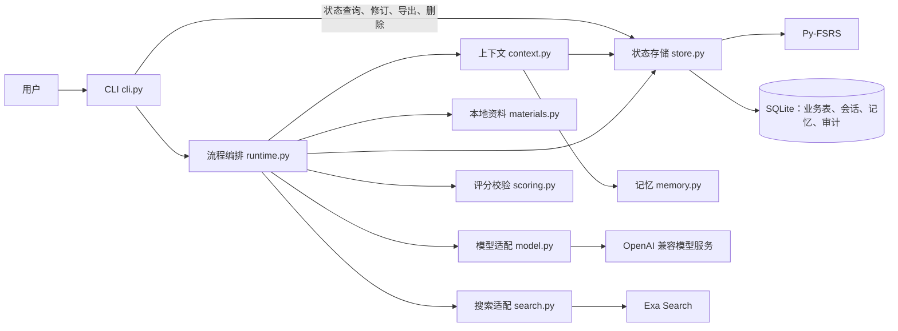
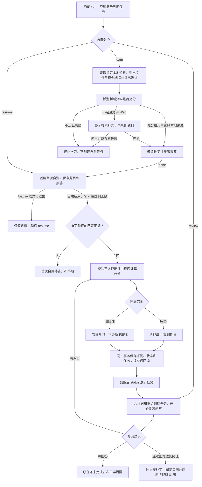

# 知秋

知秋是本地 CLI 学习 Agent。用户指定一个知识点和 `.md`／`.txt` 资料，学完后回答费曼问题；程序保存原题、原答、分维度评阅和复习任务，并按 FSRS 安排复习。模型负责教学、出题与语义评阅；业务写入、状态转换、总分计算和排期由程序执行。

## 功能概览

- **大模型接入**：OpenAI 兼容的 Chat Completions 适配器，每次调用记录耗时、token 用量与状态；按模型配置窗口、输出预留与余量。
- **上下文构建**：教学、澄清、出题、评阅分别使用版本化的固定模板；每次请求区分必需内容与可选内容，按预算取舍，并记录纳入、排除的来源及原因。连续澄清和出题在同一会话内追加消息，复用已测量的请求前缀。
- **会话与记忆**：会话跨进程恢复；语义记忆只接受用户显式设置；评阅成功后异步生成有来源的情景摘要；跨天追问旧讲解时先用摘要，来源被更正后摘要失效并按需重建。
- **评分**：同一维度可有多道题，题目难度在作答前固定；模型对每个维度给一个 0–4 分并引用原答逐字证据，程序核对题目覆盖与引文后按 50/30/20 计算总分。证据放不进一次调用时按维度、按题分批；仍无法可靠评阅时进入待评阅，不产生分数或排期。
- **评分质量检查**：人工标注模板与一致率核对工具，用于验证模型评分与人工判断的一致性。

## 项目结构与职责

```text
.
├─ src/zhiqiu/
│  ├─ cli.py          CLI 命令、用户确认和交互会话
│  ├─ runtime.py      学习／复习流程编排与模型输出校验
│  ├─ context.py      分阶段上下文组装、预算检查与审计
│  ├─ model.py        OpenAI 兼容 Chat Completions 适配器
│  ├─ scoring.py      评分标准、证据校验、加权总分与 FSRS 档位映射
│  ├─ store.py        SQLite 权威状态、迁移、事务、审计事件与 FSRS 排期
│  ├─ memory.py       显式语义记忆、情景摘要与旧讲解摘要
│  ├─ retrieval.py    旧讲解追问的可解释排序
│  ├─ materials.py    本地资料读取、范围限制和内容哈希
│  ├─ search.py       Exa Search 适配器
│  ├─ quality.py      人工标注模板与评分质量检查
│  ├─ diagnostics.py  模型联通、预算与窗口容量检查
│  ├─ local_env.py    读取项目根目录的 .env
│  └─ clock.py        系统时钟与测试用固定时钟
├─ tests/             存储、流程、上下文、评分、检索与诊断测试
├─ examples/          无密钥演示、真实服务联通与评分验收脚本
└─ labels/            人工标注与检索校准用的公开合成样本
```

设计原则是“模型提出建议，程序做出决定”。模型的输出一律视为不可信输入：`runtime.py` 校验结构，`scoring.py` 核对原题、原答与逐字证据；只有 `store.py` 改变业务状态，并在一个 SQLite 事务内保存评阅、FSRS 状态、复习任务与审计事件，提交后回读确认，CLI 才报告保存成功。



所有模型调用都经过 `LearningRuntime._invoke`：先由 `ContextManager.build` 按阶段组装请求并检查预算，再交给适配器发送，返回的必须是 JSON 对象。必需内容超预算时改用已检查过的资料摘要；服务端报告窗口溢出时去掉可选内容重试一次。调用次数与顺序由业务流程决定，没有让模型自主循环调用工具。

## 学习与复习流程

`status` 和每次启动的到期提醒只查询任务；看到提醒不会完成复习。首次自测没有可评分回答时保留待补状态，不产生首次任务。



运行边界：一次问答最多 8 题或 25 分钟。完整评阅按概念准确、机制解释、应用辨析分别给 0–4 分，权重 50/30/20，得分映射为 FSRS 的 Again、Hard、Good、Easy；阶段性评阅统一次日提醒，零回答不新建任务。`revise` 按修订后的分数重算受影响的 FSRS 状态和未开始任务的到期日。使用 Py-FSRS 6.3.2、90% 目标回忆率、365 天上限，关闭分钟级步骤和随机扰动。

## 评分

评分标准写在 `scoring.py` 的 `RUBRIC`：0 为不会或完全错误，1 为有零散正确点但关键结论错误，2 为基础正确但深层不足，3 为基本完成但有一处明显不足，4 为完全答对或只有非关键遗漏，不因题目难度封顶。题目难度分为 `basic`、`advanced`、`transfer`，在作答前固定，作答后不能修改。同一维度有未答题时，未答题覆盖的要求视为未证明：只答了基础题且答对时最高 2，已答题中有答对的进阶或迁移题时最高 3。回答含糊时先在同一维度追问一次，再按澄清后的理解评分。

程序拒绝以下评分并让模型重评，校验失败的原因会反馈给重试：同一维度出现多项、漏评或重评某道题、引文不在原答中、未答题带有证据、分数不在 0–4。重试仍未通过则进入 `awaiting_review`。

原答本身超预算时，尝试进入 `awaiting_review`，原答保留。可用 `submit-final` 另存一份精简的评分答案，再用 `resume` 继续。评原答的分段路径（`resume ATTEMPT_ID --grade-original`）把原答按段落、句子边界切成无重叠且覆盖全文的片段，逐段提取正确点、错误点、未决点与短引文，进度按尝试、答案、内容哈希、规则版本和模型版本缓存，汇总时检查跨片矛盾。该路径默认关闭，需设置 `ZHIQIU_LONG_ANSWER_SEGMENTS=1`。

## 记忆与跨天追问

- `memory set/list/delete` 管理语义记忆，需给出作用范围与来源；知识点专属的同名设置覆盖全局设置。普通对话不会被自动存为记忆。
- 跨天追问旧讲解时开启新会话，通过来源 ID 关联旧讲解；摘要按需生成并缓存，`correct-lesson` 追加更正后旧摘要失效。
- `ask` 未指定 `--source` 且有多次旧讲解时，按追问内容对旧讲解排序：汉字二元组按候选集合做 IDF 加权重合，英文与数字按整词匹配，“为什么、怎么、而不是”等疑问与虚词短语不参与匹配，再加上最长共同片段和较弱的时间衰减。最高分达到阈值且明显领先时自动选用并说明，否则列出前 3 个候选，提示用 `--source` 指定或用 `--all` 逐次处理。每次排序的分数、信号和取舍理由记为 `LessonRetrieval` 事件。排序参数用 `labels/retrieval/cases.json` 校准（`examples/calibrate_retrieval.py`）。

## 安装与配置

需要 Python 3.12 和 `uv`。以下命令在包含 `pyproject.toml` 的项目目录运行：

```powershell
uv sync --python 3.12 --extra test
uv run --python 3.12 python examples/demo.py
```

演示使用固定时钟和脚本化模型，不需要 API 密钥。

CLI 自动读取项目根目录的 `.env`（已被 Git 忽略）；已设置的进程环境变量优先。至少需要：

```powershell
$env:ZHIQIU_LLM_BASE_URL = 'https://your-provider.example/v1'
$env:ZHIQIU_LLM_MODEL = 'your-model'
$env:ZHIQIU_LLM_API_KEY = 'your-key'
# 仅需要 Web 补充时配置：
$env:ZHIQIU_EXA_API_KEY = 'your-exa-key'
```

模型端点须支持 OpenAI 风格的 Chat Completions；Web 补充还须支持工具调用。开始学习前，CLI 列出将发送的本地文件和模型端点，用户确认后才发送；Web 搜索只发送查询字符串；密钥不写入数据库或导出文件。

模型窗口与预算用 `ZHIQIU_MODEL_BUDGETS` 按模型配置，键为模型名或 `端点|模型名`（后者优先），例如：

```json
{"https://provider.example/v1|model-a": {"window": 131072, "output_reserve": 32768, "margin": 4096, "verified": false, "validation_retries": 2}}
```

输入上限为 `window − output_reserve − margin`，`output_reserve` 同时作为请求的 `max_tokens`。推理型模型的输出包含推理内容，输出预留应留足。未匹配的模型沿用 `ZHIQIU_LLM_WINDOW`、`ZHIQIU_LLM_OUTPUT_RESERVE`、`ZHIQIU_LLM_MARGIN`；缺少窗口参数时不做超限判断。`verified` 是本地配置声明，只记入审计。

上下文预算优先复用服务端报告的 `usage.prompt_tokens`：新请求完整保留某次已测量请求的消息前缀时，以报告值为基数估算新增部分；否则按 UTF-8 字节保守估算。估算方法与结果都写入请求审计。

## 命令

默认数据库位于操作系统用户数据目录的 `zhiqiu/state.sqlite`，也可用全局 `--db PATH` 指定。

```powershell
uv run zhiqiu --db .\state.sqlite learn '二叉树遍历' --from .\notes.md
uv run zhiqiu --db .\state.sqlite status
uv run zhiqiu --db .\state.sqlite resume
uv run zhiqiu --db .\state.sqlite review
uv run zhiqiu --db .\state.sqlite revise REVIEW_ID concept 3 --reason '原答支持基本正确'
uv run zhiqiu --db .\state.sqlite trace ATTEMPT_ID
uv run zhiqiu --db .\state.sqlite export --json .\backup.json
uv run zhiqiu --db .\state.sqlite forget '二叉树遍历'
uv run zhiqiu --db .\state.sqlite memory set '语言偏好' '使用 Python 示例' --source '用户明确设置'
uv run zhiqiu --db .\state.sqlite memory list --point '二叉树遍历'
uv run zhiqiu --db .\state.sqlite ask '二叉树遍历' '之前如何解释前序？'
uv run zhiqiu --db .\state.sqlite ask '二叉树遍历' '之前如何解释前序？' --all
uv run zhiqiu --db .\state.sqlite resume-all QUERY_ID
uv run zhiqiu --db .\state.sqlite correct-lesson MESSAGE_ID --text '原讲解中的更正'
uv run zhiqiu --db .\state.sqlite submit-final ANSWER_ID --text '用于评分的精简答案'
uv run zhiqiu --db .\state.sqlite resume ATTEMPT_ID --grade-original
uv run zhiqiu --db .\state.sqlite labels-template --json .\human-labels.json
uv run zhiqiu --db .\state.sqlite evaluate --labels .\human-labels.json
```

会话内 `/done` 确认学完并开始自测，`/pause` 保存问答进度，`/end` 明确结案，`/sources web|local` 纠正资料选择，`/accept N` 接受关联知识点建议，`/question 文本` 记录并解释澄清问题。直接关闭或异常退出不会自动结案。`--offline` 禁止 Web 补充。低分维度关联的原题原答会成为后续复习出题的重点。

## 验证与诊断

```powershell
uv run --python 3.12 --extra test python -m pytest -q
```

测试覆盖迁移与回滚、会话恢复、幂等任务、只读提醒、上下文预算与审计、记忆失效、多题评分与证据校验、待评阅恢复、长答分段、旧讲解排序和诊断逻辑；均使用脚本化模型，不需要密钥。

模型联通、预算与窗口容量用 `check-model` 检查，只发送公开合成文本，不输出密钥、请求正文或模型答复：

```powershell
uv run zhiqiu check-model              # 联通、模型身份与服务端 token 计数
uv run zhiqiu check-model --calibrate  # 按服务端计数扩大样本，检查所配输入上限
uv run zhiqiu check-model --boundary   # 发送接近输入上限的请求
uv run zhiqiu check-model --capacity   # 生成满额输出预留，并在接近输入上限时再生成一次
```

`--capacity` 在两次满额生成都达到输出预留的 98%、且第二次输入达到上限的 99% 时，标记 `window_size_verified`；随后发送超出窗口 3% 的请求（只要求 16 个输出 token），被拒绝说明配置与服务上限一致，被接受说明配置是保守下限。它会消耗接近整个窗口的 token。只验证检查流程时，可在命令进程中临时设置小窗口，不改 `.env`：

```powershell
$env:ZHIQIU_MODEL_BUDGETS = '{"https://provider.example/v1|model-a":{"window":16384,"output_reserve":4096,"margin":512,"verified":false}}'
uv run zhiqiu check-model --capacity
Remove-Item Env:ZHIQIU_MODEL_BUDGETS
```

真实服务的端到端检查（使用临时数据库和公开合成资料，不读取个人学习资料）：

```powershell
uv run --python 3.12 python examples/live_smoke.py
uv run --python 3.12 python examples/live_v2_smoke.py
uv run --python 3.12 python examples/live_v2_smoke.py --all-model-questions
```

评分质量用人工标注检查：`labels-template` 导出原题、原答、模型分数和证据，人工在 `human_score` 填入 0–4 后运行 `evaluate`，核对精确一致率（至少 30 项、≥80%）并逐项检查引文仍在原答中。`labels/` 中的公开合成样本可用以下脚本评分与核对：

```powershell
uv run --python 3.12 python examples/generate_label_samples.py --runs 3
uv run --python 3.12 python examples/generate_label_samples.py --set multi --runs 3
uv run --python 3.12 python examples/long_answer_samples.py
```

`--runs N` 把同一批样本评分 N 次、写入各自的数据库，并按平均精确一致率判定。

## 已知限制

- 同一输入在温度 0 下的评分仍可能相差一档，单次一致率会有波动，评分质量应按多次评分的平均值判断。
- 单道长答的分段评阅默认关闭：要点较多的长答在汇总步骤可能超出预算，需先实现分批汇总并通过人工样本检查后再启用。
- `verified` 只是配置声明，不会由程序自动推断；未做满额实测的窗口应保持 `false`。
