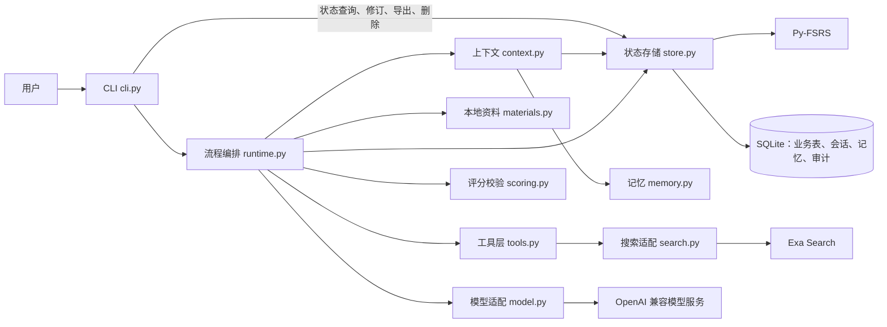
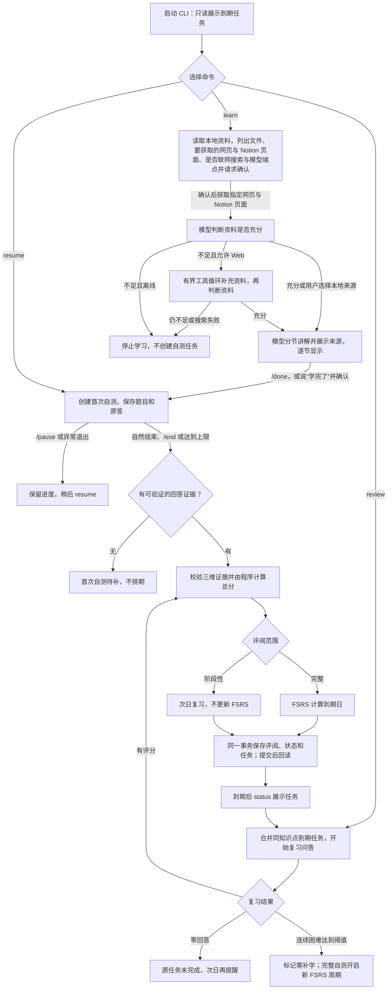

# 知秋

知秋是本地 CLI 学习 Agent。运行 `zhiqiu` 先显示学习状态，再进入自由对话；需要时由知秋建议、用户确认后进入学习、自测或复习。用户指定一个知识点和 `.md`／`.txt` 资料、网页或 Notion 页面，学完后回答费曼问题；程序保存原题、原答、分维度评阅和复习任务，并按 FSRS 安排复习。模型负责教学、出题与语义评阅；业务写入、状态转换、总分计算和排期由程序执行。

## 功能概览

- **大模型接入**：OpenAI 兼容的 Chat Completions 适配器，每次调用记录耗时、token 用量与状态；按模型配置窗口、输出预留与余量。
- **上下文构建**：教学、澄清、出题、评阅分别使用版本化的固定模板；每次请求区分必需内容与可选内容，按预算取舍，并记录纳入、排除的来源及原因。连续澄清和出题在同一会话内追加消息，复用已测量的请求前缀。
- **会话与记忆**：会话跨进程恢复；语义记忆只接受用户显式设置；评阅成功后异步生成有来源的情景摘要；跨天追问旧讲解时先用摘要，来源被更正后摘要失效并按需重建。
- **评分**：同一维度可有多道题，题目难度在作答前固定；模型对每个维度给一个 0–4 分并引用原答逐字证据，程序核对题目覆盖与引文后按 50/30/20 计算总分。证据放不进一次调用时按维度、按题分批；仍无法可靠评阅时进入待评阅，不产生分数或排期。
- **评分质量检查**：人工标注模板与一致率核对工具，用于验证模型评分与人工判断的一致性。
- **对话与运行时**（V4）：默认自由对话（有界 ReAct 循环，可用全部工具）；模型只能“提议”进入流程或记住偏好，由用户确认、程序执行。业务状态和对话模式都有显式的状态转换表，每次迁移写事件，中断后读状态字段恢复。
- **观测与治理**（V5）：每轮对话或每次命令一条 trace（span 树，开始时即落库）；`zhiqiu dashboard` 本地网页看板实时显示运行到哪一步，并有 trace 瀑布图、指标与花费、学习记录；`metrics` 汇总成功率、延迟、token、花费与人工确认；护栏每次触发写 `GuardrailTriggered`，密钥按值集中脱敏；`check` 对真实记录做运行契约检查，`failures` 分类失败并可导出为回归样例；`gate` 是发布门禁。见“观测与治理”。
- **界面与审批**（V6）：对话中的联网、外部 MCP、写文件按审批策略自动执行、询问或不提供（默认联网自动、其余询问，`ZHIQIU_APPROVAL_CONFIG` 可改，写文件不能自动）；每次放行记下来源（策略、用户、本轮已允许），每次询问留一条审批记录。`zhiqiu web` 本地网页工作台：在浏览器里对话、走完学习与复习、在卡片上批准或拒绝动作，右侧状态面板显示当前目标、上下文范围、执行状态、风险动作与验证结果；写接口只接受本机页面带令牌的请求。见“审批策略”“网页工作台”。
- **循序渐进的讲解**（6.1）：讲解分成 3–5 节逐节显示，每节一个小目标、结尾一个检查问题，说“继续”看下一节、说“学完了”开始自测；澄清只回答当前问题，不复述内部状态，也不宣布程序动作；对话中提议学习时一并列出要发送的资料，确认一次即可。见“讲解方式”。
- **学习体验与会话切换**（V7）：出题一题一问（程序校验问号数和长度，不合格重出一次）；评阅默认每个维度一行，`/detail` 或网页“展开详情”看原题原答与完整理由；自测中半答半问的输入可以拆开处理，每次分类都留痕；老讲解按“一、二、三”标题分节继续；会话有标题（命令规则、模型首轮命名、用户改名），工作台左侧会话侧栏可以切换、新建、改名，界面不再显示完整 UUID。见“自测中的出题与输入”“评阅结果的显示”“会话与切换”。
- **教学 Skill**（7.2）：讲解和澄清的“怎么教”放在带版本号的 `SKILL.md` 文件里（内置“通用讲解”和“费曼学习法”，也可以在自己的 Skill 目录里加），规则和输出结构仍写在代码里；渐进式披露：资料评估时模型只看到各个 Skill 的名称和描述，顺带选一个，程序校验后讲解和澄清才读入它的正文；`/skill` 查看或指定讲法，trace 记下用了哪个 Skill、哪一版、谁选的、为什么。见“教学 Skill”。
- **讲解配图与本地语音**（7.2）：讲解某一节可以带一张流程图、树或概念图（程序校验，工作台画成 SVG，终端打印文字版）；工作台按住麦克风说话，本机 SenseVoice-Small（sherpa-onnx，CPU）离线转写，按知识点标题修正同音术语，填进输入框由你确认后发送，录音不保存，来自语音的回答带“语音”标记。见“教学 Skill”“语音输入”。
- **复习日程、目录白名单与审批页**（7.1）：看板“复习日程”按周、月显示逾期、今天和未来的复习，加未来 14 天负载（超过每日 3 次的那天标红），工作台里点到期条目即开始复习；工作台“目录白名单”页可以粘贴绝对路径、先预览再添加或移除可读／可写目录，在两轮对话之间生效、不用重启，环境变量里的目录只能看，每次改动记 `RootsChanged`，知秋自己没有任何办法改这份名单；审批页可以直接批准或拒绝工作台正在等待的动作。见“本地看板”“网页工作台”。

## 项目结构与职责

```text
.
├─ src/zhiqiu/
│  ├─ cli.py          CLI 命令、终端输入输出与用户确认
│  ├─ agent.py        `zhiqiu chat` 对话外壳：有界 ReAct 循环、提议与确认、斜杠命令
│  ├─ approvals.py    对话审批策略：联网、外部 MCP、写文件按 allow／ask／deny 执行
│  ├─ webio.py        网页工作台的 FlowIO（事件日志、等待网页回答的提示）与运行对话的工作线程
│  ├─ conversations.py 对话与对话消息的保存、按天划分、模式切换与删除
│  ├─ flows.py        讲解、自测与复习的输入循环（终端与对话模式共用）
│  ├─ lessons.py      讲解分节：校验、渲染、进度标记与“继续／学完了”的识别
│  ├─ flow.py         状态转换表与统一的状态转换入口
│  ├─ runtime.py      学习／复习流程编排与模型输出校验
│  ├─ context.py      分阶段上下文组装、预算检查与审计
│  ├─ model.py        OpenAI 兼容 Chat Completions 适配器
│  ├─ scoring.py      评分标准、证据校验、加权总分与 FSRS 档位映射
│  ├─ store.py        SQLite 权威状态、迁移、事务、审计事件与 FSRS 排期
│  ├─ notion.py       Notion 官方 API 读取页面并转成 Markdown
│  ├─ mcp_client.py   连接本地 stdio MCP 服务，白名单工具接入工具层
│  ├─ mcp_server.py   `zhiqiu mcp`：只读 MCP 服务（stdio），审计写 JSONL
│  ├─ queries.py      状态、到期、知识点与 trace 的只读查询（Store 与只读工具共用同一份 SQL）
│  ├─ memory.py       显式语义记忆、情景摘要与旧讲解摘要
│  ├─ retrieval.py    旧讲解追问的可解释排序
│  ├─ history.py      对话工具 search_history：讲解与对话的 FTS5 关键词检索
│  ├─ materials.py    本地资料读取、范围限制和内容哈希
│  ├─ search.py       Exa Search 适配器与 web_search 工具声明
│  ├─ tools.py        工具声明、注册、参数校验、执行闸门、重试、截断与审计
│  ├─ toolloop.py     资料准备与学习阶段澄清内的有界工具循环、搜索查询泄露检查
│  ├─ files.py        read_file（只读已授权资料）与 write_file（只写指定目录、逐次确认）
│  ├─ quality.py      人工标注模板、评分质量检查、评分提示指纹与评测记录
│  ├─ tracing.py      trace：span 树、当前 span（contextvars）、进度与中断标记
│  ├─ traces.py       trace 列表、树、实时运行链与终端时间线
│  ├─ metrics.py      指标聚合（读取时计算）；pricing.py 按 token 推算花费
│  ├─ guardrails.py   护栏触发的统一事件；redact.py 按值脱敏
│  ├─ contracts.py    运行契约检查（PASS／FAIL／证据不足）与失败分类
│  ├─ regressions.py  校验失败的模型原文导出为回归样例
│  ├─ gate.py         发布门禁
│  ├─ dashboard.py    `zhiqiu dashboard` 本地只读看板（dashboard.html 为页面）
│  ├─ diagnostics.py  模型联通、预算与窗口容量检查
│  ├─ local_env.py    读取项目根目录的 .env
│  └─ clock.py        系统时钟与测试用固定时钟
├─ tests/             存储、流程、上下文、评分、检索与诊断测试；test_scenarios.py 为端到端场景套件，
│                     regressions/ 为从真实失败沉淀的回归样例
├─ examples/          无密钥演示、真实服务联通与评分验收脚本
├─ scripts/           Windows 桌面入口：zhiqiu-web.ps1 打开工作台，install-shortcut.ps1 生成桌面快捷方式
└─ labels/            人工标注与检索校准用的公开合成样本；eval-runs.jsonl 为评分评测记录（随代码提交）
```

设计原则是“模型提出建议，程序做出决定”。模型的输出一律视为不可信输入：`runtime.py` 校验结构，`scoring.py` 核对原题、原答与逐字证据；只有 `store.py` 改变业务状态，并在一个 SQLite 事务内保存评阅、FSRS 状态、复习任务与审计事件，提交后回读确认，CLI 才报告保存成功。



所有模型调用都经过 `LearningRuntime._invoke`：先由 `ContextManager.build` 按阶段组装请求并检查预算，再交给适配器发送，返回的必须是 JSON 对象。必需内容超预算时改用已检查过的资料摘要；服务端报告窗口溢出时去掉可选内容重试一次。业务流程中的调用次数与顺序由程序决定；只有对话模式和两个学习步骤开放有界工具循环（见“工具层”“对话模式”）。

## 学习与复习流程

`status` 和每次启动的到期提醒只查询任务；看到提醒不会完成复习。首次自测没有可评分回答时保留待补状态，不产生首次任务。



### 讲解方式

讲解一次生成（只调用一次模型），分成 3–5 节逐节显示。每节只讲一个小目标，先讲直觉再讲细节，正文不超过 300 字，结尾是一个一两句话就能回答的检查问题（“想一想：……”）。事实以资料为准，但不按资料的顺序和措辞复述。讲解阶段可以：

- 回答检查问题或直接提问：交给澄清，模型会拿到当前这一节和它的检查问题，简短指出答对的地方和缺少的地方；
- 说“继续”“下一节”“接着讲”：显示下一节，不调用模型；最后一节之后显示可独立学习的建议（`/accept N`）；
- 说“学完了”“讲完了”“开始自测”等：先确认“结束讲解，开始自测吗？”（还有没看的节时会注明），确认后等同 `/done`；输入 `/done` 不再确认。

这些说法只在去掉空格和句末标点后完全一致时才识别，“懂了”“明白了”不算（它们也可能是在回答检查问题）。整篇讲解仍作为一条 `lesson` 消息保存，出题、评阅和澄清的上下文不变；各节内容记在 `LessonSections` 事件里，每显示一节写一条 `lesson_section` 标记，所以 `/resume` 会列出各节标题并从第一节没看过的继续。

分节之前（6.1.0 以前）的旧讲解恢复时，如果有两个以上行首的中文序号标题（“一、”“二、”……），就按标题切成几节：第一个标题之前的内容是“概述”，最后的“补充：……”留在最后一节，同样逐节显示并留下 `lesson_section` 标记，下次从没看过的一节继续（跨天继续时标记仍指向原讲解）。切分每次现算，不调用模型，也不改存储的讲解原文；没有序号标题的旧讲解照旧整篇显示。

### 教学 Skill（7.2）

讲解（`teach`）和澄清（`clarify`、分段核对后的 `clarify_combine`）的提示由三部分拼成：代码里的固定开头 → Skill 里这一阶段的教法 → 代码里的篇幅、配图、规则和输出结构，最后是共用的数据规则。固定部分在 Skill 之后，所以哪个 Skill 都去不掉“事实以资料为准”“不提内部记录”“不宣布程序动作”这些规则，也改不了输出的 JSON 结构。

- **内置 Skill**（`src/zhiqiu/skills/<名称>/SKILL.md`，随包发布）：`general`（通用讲解，就是 7.1 之前写死的那套教法，兜底用）和 `feynman`（费曼学习法：先用大白话和日常类比讲清核心、少用术语，每节让你用自己的话复述，澄清时先肯定说对的、再指出复述里最多两处漏洞，请你再说一遍）。
- **自己的 Skill**：放在 `ZHIQIU_SKILLS_DIR`（默认 `%LOCALAPPDATA%\zhiqiu\skills`），每个子目录一个 `SKILL.md`。改了文件下一次 `/learn` 就生效，不用重启。格式：

  ```markdown
  ---
  name: leetcode            # 小写字母、数字、连字符，与目录同名
  version: 1                # 改内容时自己加 1（trace 另记内容摘要）
  title: 刷题讲解            # ≤20 字
  description: 算法题：先手推小例子，再给解题模板和复杂度   # ≤120 字，模型选 Skill 时只看这一句
  stages: [teach]           # teach 必填；不写 clarify 时澄清用通用讲解
  sections: 2-4             # 可选：节数 1–8，默认 3-5
  section_chars: 300        # 可选：每节字数 100–800
  answer_chars: 200         # 可选：澄清回答字数 80–500
  diagrams: 1               # 可选：一份讲解最多几张图 0–3，默认 0
  ---

  ## teach

  （怎么讲，30–1500 字，不能有花括号）
  ```

  不合规、和内置 Skill 同名、或者总数超过 20 个的，只跳过那一个，原因列在 `zhiqiu skills` 和工作台状态面板里；内置 Skill 坏了则直接报错。Skill 正文会进入讲解和澄清的系统提示，信任级别等同你自己写的指令：从网上复制的 Skill 先读一遍再放进来。
- **谁也改不了 Skill 目录**：可写目录（环境变量或工作台白名单）不能是 Skill 目录本身、它的上级或下级，白名单预览会直接拒绝；如果 `.env` 里的可写目录和 Skill 目录重叠，全部用户 Skill 停用并给出警告。知秋没有任何工具能写 Skill。
- **怎么选（渐进式披露）**：资料评估（`assess`／`assess_combine`）的输入里多一份 Skill 目录，只有名称、标题和描述，模型除了判断资料够不够，再返回 `skill` 和一句 `skill_reason`。程序校验名称存在且能讲解，否则用 `general` 并在 trace 标出 `skill_invalid`，学习照常进行。选中的 Skill 记到知识点上（`SkillChanged` 事件带理由），之后对这个知识点的澄清也用它。不额外调用模型。
- **`/skill`**：讲解、自测、复习中 `/skill` 列出可用的 Skill 并标出当前用的是哪个、谁定的；`/skill 名称`（或中文标题）改当前知识点，`/skill auto` 交还给模型；对话里写 `/skill 名称 知识点标题`、`/skill auto 知识点标题`。你指定的不会被模型覆盖；指定的 Skill 被删了就本次用通用讲解并提示。改了不自动重讲，想用新讲法再 `/learn` 一次。斜杠命令不调用模型。
- **观测**：讲解卡片上方一行“讲法：费曼学习法（/skill 可改）”；Trace 详情里资料评估一步显示“选择 Skill：feynman（理由：……）”，讲解和澄清显示所用 Skill、来源（内置／用户）和谁定的（模型／用户／通用兜底）；模型调用详情显示 Skill 名、版本和内容摘要；`context_builds` 记 `skill_name`、`skill_version`、`skill_sha`、`skill_source`，`zhiqiu check` 的 `skills_recorded` 检查每次讲解和澄清都记了 Skill。`zhiqiu skills [--json]` 列出所有 Skill 和错误。
- **讲解配图**：Skill 的 `diagrams` 允许时（两个内置 Skill 都是 2），讲解的某一节可以带一张图：`flow`（流程图，带箭头，可以有回路）、`tree`（树，单根）或 `map`（概念图，连线写关系），每张 2–12 个节点、1–20 条连线，节点要连成一片。程序逐项校验：同一条连线写了两次会合并成一条（标签用“／”连起来），其他不合规的只丢掉这张图（这一节的文字照常显示），原因记在 `LessonSections` 事件的 `dropped_diagrams` 里，讲解这一步的 span 记 `diagram_invalid`。图的文字形式（树用 `├─`／`└─`，流程和概念图每条连线一行 `A —标签→ B`）也写进保存的讲解原文，所以出题、评阅和澄清都看得到图里的内容；终端直接打印文字形式。工作台用原生 SVG 画在这一节正文和检查问题之间（分层布局，回路画成虚线弯边，深浅主题都可读），比卡片宽时只在图里横向滚动，图下有“文字版”开关。
- **讲解输出无法解析**：带图的讲解是一段较长的 JSON，模型偶尔会写坏（7.2 实测 10 次里 1 次）；讲解阶段遇到无法解析的输出会自动再请求一次（原文照常记进 `llm_failures`），第二次仍失败才报错停止。
- **版本**：7.2 改了这几个阶段的结构和资料评估的提示，`TEMPLATE_VERSION` 升为 `context-v15`（资料片段检查、分段追问、旧讲解归纳三张缓存各失效一次）；以后只改 Skill 不再升它。内置 Skill 内容变了而 `version` 没升，测试会失败。评分和分类的提示没有动；出题规则 `FOLLOWUP_RULES` 加了一句复习重点的说明（见下），评分提示指纹因此从 `dc26363f8ed3` 变为 `4a7d7e1fac39`。
- **复习重点**：复习时出题阶段会收到以前得分不超过 2 的旧题、旧回答和评分理由（`focus`）。它们不带题目和回答的 id，出题规则也写明 focus 不是本次问答的记录：本次已答的题只看 `current_attempt`，focus 里的题既不算已作答，也不能被追问，复习要针对其中的错点出新题。7.2 之前这里带着旧题 id，真实复习中模型把旧题当成本次已答的题，一开题就回 `done` 或去追问旧题，复习无法开始。

### 自测中的出题与输入

出题一题一问（V7）：`next_question` 的提示要求每题只含一个问号、题干不超过 60 字、2 到 4 句话能答完；需要手推的题由题目给一个最小例子，只问其中一步；追问只针对原答里最含糊的一句，可以引用原话，不得重复或改写原题，也不得要求“展开讲”。程序在保存题目前用 `scoring.question_shape` 校验：中英文问号合计超过 `QUESTION_MAX_MARKS = 1` 个，或去掉空白后超过 `QUESTION_MAX_CHARS = 80` 字（提示写 60，校验留余量），就带着原因重出一次，第一次的输出记入 `llm_failures`。重出后仍只是形状超限时题目照样保存、自测继续，并记一条 `GuardrailTriggered(rule=question_shape, action=warned)`；字段缺失、维度或追问目标非法等结构性错误仍然中止并保持可恢复。字面相似度拦不住“换个说法重问原题”，这一点靠提示约束和回归样本人工审阅。

不带前缀的自测输入先由 `classify_turn` 判断：

| 模型判断 | 处理 |
|---|---|
| `answer` 回答 | 直接保存为回答 |
| `question` 提问 | 提示“识别为提问，回车确认，输入 a 改为回答保存” |
| `mixed` 半答半问（拆分合法） | 提示三选一：回车＝分开处理（回答部分存为回答，提问部分走澄清），a＝整段作为回答，q＝整段作为提问 |
| 调用失败、拿不准、拆分不合法 | 让用户选 a（回答）或 q（提问） |

`mixed` 时模型须给出 `answer_text` 和 `question_text`，程序去掉首尾空白和标点后检查两段都不为空、都是原输入的子串，否则降级为“拿不准”。分开处理时评分只看得到回答部分。每次分类写一条 `TurnClassified` 事件：`question_id`、`model_kind`、`reason`（截到 200 字）、`split_valid`、`final`（answer／question／split）、`decided_by`（模型直接处理为 `model`，用户在提示里选择为 `user`）和 `input_chars`，**不存输入原文**；`flow` span 记 `classified_mixed` 次数，看板的学习记录详情列出这些分类。

### 评阅结果的显示

自测或复习结束后只显示摘要（V7）：

```
阶段性评阅 25 分 · 下次复习 10-17（明天）
  概念准确 1/4：只说了“链表只有 next”，没讲遍历是什么
    要点：遍历是按规则访问每个节点一次
  机制解释 3/4：说清了递归调用的顺序
  应用辨析：未评
输入 /detail 查看原题、原答和完整理由
```

每个维度一行：优先用评分给出的 `feedback`（给学习者看的一句话，提示要求不超过 60 字，存在 `dimension_scores.feedback`；缺失或超过 80 字时存空，不影响评分是否成立），没有时取 `rationale` 第一个句号之前的内容，超过 40 字截断。得分不超过 2 的维度另起一行“要点”，取 `supplement` 的第一句。之后回到对话只说“已回到对话。”，不再重复总分（`flow_result` 消息仍存完整摘要，状态面板“最近结果”照常显示）。`/detail` 显示本段对话最近一次评阅的完整内容（每个维度的引文、完整理由、补充，以及原题、原答），`/detail 短号` 查看指定尝试；自测进行中输入 `/detail` 会提示结束后再看。网页上摘要显示为评阅卡片，“展开详情”直接读只读的 `/api/attempt/<id>`，对话忙时也能展开。

澄清（讲解与自测中的提问）只回答当前这一个问题，先给结论，一般不超过 200 字；不提数据库字段或学习状态，不宣布、也不承诺程序动作（结束讲解、开始自测、安排复习、生成任务）。讲解中的澄清可以读资料、写笔记，但不提供对话用的状态查询工具。

### 状态机

业务状态只能经 `flow.py` 的 `transition`／`enter` 改变：先按声明的转换表检查，合法才更新字段，并在同一事务内写一条 `StateChanged` 事件（实体、ID、原状态、新状态、原因）；表外的转换抛出 `IllegalTransition`（`ValueError` 的子类），字段和事件都不变。声明为“到自身”的转换（如进行中的尝试再次 `resume`）不改字段、不写事件。原有的业务事件（`AttemptPaused`、`ReviewSaved` 等）照常写入。

| 实体（字段） | 转换 |
|---|---|
| 尝试（`attempts.state`） | 新建→`in_progress`；`in_progress`→`paused`／`awaiting_review`／`completed`／`needs_self_test`；`paused`、`needs_self_test`→`in_progress`；`awaiting_review`→`completed`；`completed` 为终点 |
| 复习任务（`review_tasks.state`） | 新建→`pending`；`pending`→`started`／`relearn_handled`；`started`→`done`／`pending`（零回答推迟）／`relearn_handled`；`relearn_handled`→`pending`（修订撤销补学）；`done` 为终点 |
| 知识点（`knowledge_points.state`） | 新建→`active`；`active`↔`needs_relearn` |
| 讲解（`sessions.lesson_state`） | 新建→`teaching`；`teaching`→`tested`（同日开始自测）／`closed`（`/end` 或跨天续讲时关闭旧会话）；`tested`、`closed` 为终点 |
| 对话（`conversations.mode`） | 新建→`chat`；`chat`→`lesson`／`self_test`／`review`；`lesson`→`self_test`／`chat`；`self_test`、`review`→`chat` |

待继续的讲解直接读 `lesson_state='teaching'`，不再从消息推算。讲解关闭后，当天再开始的讲解进入新会话，可以正常继续。v14 迁移按已有消息回填 `lesson_state`（已关联尝试为 `tested`，有关闭记录为 `closed`，其余有讲解的会话为 `teaching`）。

运行边界：一次问答最多 8 题或 25 分钟。完整评阅按概念准确、机制解释、应用辨析分别给 0–4 分，权重 50/30/20，得分映射为 FSRS 的 Again、Hard、Good、Easy；阶段性评阅统一次日提醒，零回答不新建任务。`revise` 按修订后的分数重算受影响的 FSRS 状态和未开始任务的到期日。使用 Py-FSRS 6.3.2、90% 目标回忆率、365 天上限，关闭分钟级步骤和随机扰动。

## 对话模式

`zhiqiu chat`（或在交互终端中直接运行 `zhiqiu`）先显示完整状态，再进入对话；脚本和管道中直接运行 `zhiqiu` 仍只显示状态。每一轮：

1. 用户的话先写入 `conversation_messages`。
2. 用 `chat` 模板组装请求：固定规则、本段对话开始时冻结的偏好与人设记忆、学习状态快照、可读与可写目录是必需内容；较早对话的摘要和摘要之后的原文是可选内容，超出预算时先丢摘要之后最旧的原文，最后才丢摘要。
   - 学习状态快照只在对话启动和每次流程结束后刷新，两次刷新之间系统提示保持不变，请求前缀可以复用；对话中需要最新状态时由模型调用 `zhiqiu_status`。
   - 工具循环每次模型调用后记下服务端报告的 `prompt_tokens`（与业务流程的 `observe_usage` 同一机制），之后保留该前缀的请求按“已测量前缀 + 新增部分”估算预算。
   - 滚动摘要：未被摘要的历史估算超过输入上限的 70%（未配置预算时为超过 40 条）时，保留最近 10 条原文，把更早的消息连同已有摘要交给 `chat_summary` 阶段生成新摘要，写入 `chat_summaries`（记录覆盖到的消息序号与来源哈希），原文不删除；输入过长时只取较早的一半再试；生成失败时记入 `last_error`，本轮退回为丢弃最旧消息，照常回答。
3. 进入有界工具循环（沿用 V3：最多 5 轮、总时限 180 秒；用完时再要一次不调用工具的文字回答，最多等 30 秒）。回答写入对话记录，结束状态与轮数记在消息的 `payload_json` 中；拿不到回答时记入 `conversations.last_error`，对话继续。

对话中的工具规则：

| 工具 | 规则 |
|---|---|
| `read_file` | 只读可读目录（`ZHIQIU_READ_ROOTS` 加上工作台“目录白名单”页添加的，每轮开始时合并）中的 `.md`/`.txt`，白名单外、`..`、符号链接一律拒绝；配置白名单即表示同意把其中的文件发送到模型端点，读取时不再逐次确认 |
| `write_file` | 同 V3：只写可写目录（`ZHIQIU_WRITE_ROOTS` 加上工作台添加的），每次确认，覆盖前备份；审批策略不能把它设为自动执行；没有可写目录时不提供给模型 |
| `web_search`、`fetch_url` | 按审批策略（默认自动执行）：自动执行时仍逐条显示查询或网址（标注“自动”）；设为询问时调用前确认，同一轮对话中允许过一次后，该工具在本轮剩下的调用不再询问，但仍逐条显示（标注“本轮已允许”），拒绝不会被记住；参数不得包含本次运行中读到的笔记原文（连续 15 字），这条检查不受审批策略影响；`--offline` 时不提供 |
| 外部 MCP 工具 | 按审批策略（默认每次调用前确认，显示参数）；其余同上 |
| `zhiqiu_*` | 只读业务查询，直接执行 |
| `search_history` | 按关键词搜索以前的讲解（含追问解答）与对话消息，返回知识点、日期和命中片段，直接执行；不含当前这段对话，只在对话中提供、不经 MCP 开放。见下方“历史检索” |
| `propose_learn`、`propose_review`、`propose_resume`、`propose_memory` | 权限类别 `propose`：只提出建议，调用后工具循环立即结束，同一轮中排在它之后的调用不执行 |

审批策略（`approvals.py`，V6）决定对话中联网、外部 MCP 与写文件这三类工具是自动执行（`allow`）、每次询问（`ask`）还是不提供（`deny`）。默认联网自动执行，外部 MCP 与写文件询问。用 `ZHIQIU_APPROVAL_CONFIG` 指向一个 JSON 文件即可修改，工具名的设置优先于权限类别：

```json
{
  "permissions": {"network": "allow", "external_mcp": "ask", "write_file": "ask"},
  "tools": {"fetch_url": "ask", "notion__search": "allow"}
}
```

外部 MCP 工具按注册名 `服务__工具` 填写。配置有误（未知字段、非法值、把写文件设为 `allow`）时对话不会启动并说明原因；写了未注册的工具名只提示。`deny` 的工具不交给模型，模型仍调用时被拒并记护栏 `policy_denied`。审批策略只管对话；`learn` 开始前发送资料的确认不受影响。每轮对话的 trace 记有当时策略的指纹（`approval_policy`）。

每次询问用户（策略为 `ask`，且不是“本轮已允许”）都在 `approval_requests` 写一条记录：询问时为 `pending`，回答后改为 `approved` 或 `denied`，并记下在哪个界面回答（`terminal`，以后还有 `web`）和对应的工具调用；询问中按 Ctrl+C 记为 `cancelled`。记录只保存描述的第一行（如“写入文件：路径”）和脱敏的参数摘要，写文件的正文只记字数。对话启动时，把这段对话遗留的、以及超过 30 分钟仍未回答的 `pending` 标为 `cancelled`。`chat forget` 一并删除该对话的审批记录，`export` 包含这张表。

历史检索（`history.py`）用 SQLite 自带的 FTS5 全文索引，不用 embedding，也不调用模型：文本按旧讲解追问的同一规则切成中文二字词（去掉“什么”“为什么”等疑问词），以空格连接后建索引，用 BM25 排序，所以“旋转”这样的两字词也能命中。索引在每次检索前补上新增的讲解和对话、去掉已删除的；`forget` 与 `chat forget` 在同一事务里删掉对应索引项，并开启 FTS5 的 secure-delete。所用 SQLite 不含 FTS5 时不提供该工具。

提议由程序先按业务规则检查（资料须在可读目录内、复习须已到期且当日不超过 3 次、要继续的尝试或讲解须存在），不可执行时直接说明原因；可执行时展示并请用户确认，确认后才切换对话模式、进入 `flows.py` 中的流程。学习提议会同时列出将发送到模型端点的本地文件、网页与是否联网补充（与 `learn` 的发送确认是同一份清单），回答“要开始吗？”即同意发送；进入流程后清单不变就不再询问（显示“发送资料已在开始前确认”），有变化才重新确认。自己输入的 `/learn` 和终端的 `zhiqiu learn` 照旧在流程里确认一次发送；讲解中用 `/sources web|local` 重新准备资料时也会再确认。同一提议用 `receipts` 中的 `proposal:<消息ID>` 防止重复执行。流程结束、暂停或中断后回到对话，并写一条 `flow_result` 摘要。

斜杠命令由程序直接执行，不经过模型：`/status`、`/learn 知识点 [--from 路径] [--url 网址] [--notion 页面]`、`/review [知识点]`、`/resume [短号]`、`/detail [短号]`、`/chats`、`/open 编号|短号`、`/title 新标题`、`/memory`、`/new`、`/help`，终端里还有 `/exit`。用户自己输入的命令不需要再确认是否进入流程。界面上的尝试、讲解和对话都用 8 位短号表示（`/status` 里是“短号 1fc9d266”），`/resume`、`/detail`、`/open` 和终端的 `zhiqiu resume` 接受至少 6 位的唯一前缀，前缀不唯一时列出候选；完整 ID 仍然可用。

中断与恢复：模型调用或工具执行中按 Ctrl+C 只取消当前一轮（写一条“已取消”）；在输入提示处按 Ctrl+C 或 EOF 退出对话，对话仍保持打开；确认提示中按 Ctrl+C 视为拒绝。启动时若对话模式停在流程中（例如上次崩溃），以业务表为准改回 `chat`（事件原因 `reconcile`），并提示可以 `/resume` 的自测或讲解，不会自动进入。

对话记录：

- 按天划分：当天再次进入接着当天的对话，第二天自动开新对话；`/new` 随时开新对话，`zhiqiu chat --resume ID` 回到旧对话。开场白是“新对话。输入 /help 查看命令。”或“接着「标题」（N 条消息）……”，只有终端另外提示 `/exit 退出`。
- 会话与切换（V7，schema v20 给 `conversations` 加了 `title` 与 `title_source`）：本段对话的第一条输入是 `/learn X`、`/review X`、`/resume` 时，执行前直接命名为“学习：X”“复习：X”“继续：知识点”（`rule`）；否则第一轮回答显示之后调用一次 `conversation_title` 阶段（输入为第一句话和第一条回复各前 500 字，脱敏后发送；不在评分指纹里），清洗后 2 到 16 字为合格（`model`），不合格或调用失败就用第一句话的前 20 字（`fallback`），失败记入 `llm_failures`，不打扰对话。`/title 新标题`（清洗后 1 到 30 字）或网页侧栏改名记为 `user`，之后不再被覆盖。没有标题的老会话在列表里现算回退标题，不回填数据库。`/chats` 列出最近 10 段有消息的对话（带编号），`/open 编号` 只认刚列出的编号，中间有任何其他输入就要重新 `/chats`；`/open 短号` 随时可用。切换时照常取消该对话遗留的待审批。
- 永久保留，不自动清理。`zhiqiu chat list` 列出、`zhiqiu chat log ID` 查看（消息、摘要、模式切换事件、工具调用），`zhiqiu chat forget ID|--all` 删除；删除时一并删除该对话的摘要与审批记录；工具审计保留，但不再关联到对话。`export` 包含对话与摘要表。
- 偏好与人设：模型可用 `propose_memory` 提议记住用户明确表达的长期偏好（key 以 `pref.` 或 `soul.` 开头，单条不超过 300 字，这两类合计不超过 2000 字）；用户确认后才写入语义记忆，来源记为 `chat:<消息ID>`。每段对话开始时冻结一份全局记忆快照，本段对话中新记住的内容从下一段对话开始生效；讲解、澄清照常使用全局记忆，评分不使用。

## 评分

评分标准写在 `scoring.py` 的 `RUBRIC`：0 为不会或完全错误，1 为有零散正确点但关键结论错误，2 为基础正确但深层不足，3 为基本完成但有一处明显不足，4 为完全答对或只有非关键遗漏，不因题目难度封顶。题目难度分为 `basic`、`advanced`、`transfer`，在作答前固定，作答后不能修改。同一维度有未答题时，未答题覆盖的要求视为未证明：只答了基础题且答对时最高 2，已答题中有答对的进阶或迁移题时最高 3。回答含糊时先在同一维度追问一次，再按澄清后的理解评分。

程序拒绝以下评分并让模型重评，校验失败的原因会反馈给重试：同一维度出现多项、漏评或重评某道题、引文不在原答中、未答题带有证据、分数不在 0–4。重试仍未通过则进入 `awaiting_review`。

原答本身超预算时，尝试进入 `awaiting_review`，原答保留。可用 `submit-final` 另存一份精简的评分答案，再用 `resume` 继续。评原答的分段路径（`resume ATTEMPT_ID --grade-original`）把原答按段落、句子边界切成无重叠且覆盖全文的片段，逐段提取正确点、错误点、未决点与短引文，进度按尝试、答案、内容哈希、规则版本和模型版本缓存，汇总时检查跨片矛盾。该路径默认关闭，需设置 `ZHIQIU_LONG_ANSWER_SEGMENTS=1`。

## 工具层

工具调用由程序决定在哪一步发生，模型最多提出参数。每个工具用 `ToolSpec` 声明名称、参数（JSON Schema 子集，必须 `additionalProperties=false`）、权限类别（`read`、`network`、`write_file`、`external_mcp`）、超时、重试次数和输出上限；同名工具重复注册直接报错，并写明两边的来源。模型看到的函数声明由同一份声明生成。

所有调用经过 `ToolExecutor.run`，顺序为：查找 → 参数校验（只校验、不纠正，失败不执行）→ 闸门（本步骤未允许该权限类别时拒绝；需要确认的工具在缺少确认回调、回调出错或用户拒绝时一律拒绝）→ 执行 → 截断输出 → 审计。失败用固定的错误类型表示：`invalid_args`、`denied`、`timeout`、`network`、`rate_limited`、`upstream`、`not_found`、`internal`；只有 `network`、`timeout`、`rate_limited` 按指数退避重试。网络请求流式读取响应，每读一块检查一次总时限，超时即中断。

每次调用写一行 `tool_calls`：工具、来源、权限、关联的知识点或尝试、参数摘要（字符串截到 200 字，名称含 key、token、secret 等的字段不记录）、是否经确认及由谁放行（`approval_source`：`policy` 审批策略、`user` 用户当场批准、`turn` 本轮已允许；V6 起记录，schema v19）、状态、错误类型、尝试次数、耗时、结果数和输出字数。`trace` 会列出该尝试及其知识点准备阶段的工具调用；`export` 与 `forget` 同样覆盖这张表。V2 的 `search_calls` 只保留为历史，不再写入。

目前注册的工具有 `notion_page`（只供程序调用，见“Notion 页面资料”）、业务只读查询 `zhiqiu_status`、`zhiqiu_due`、`zhiqiu_knowledge_point`（资料只列清单、不含全文）、`zhiqiu_trace`（输出上限 20,000 字），以及 `read_file`、`write_file`（见下）、`fetch_url`（Exa contents 接口，只接受 http/https，网络类错误重试 1 次）和 `web_search`（Exa，30 秒总时限，网络类错误重试 1 次；为节省 token，每条结果最多 1500 字，每次调用合计最多 6000 字）。

业务流程中开放工具循环（受限 ReAct）的步骤只有两个：资料准备和学习阶段的澄清（`learn` 或讲解恢复时的提问）；对话模式另有自己的工具规则（见“对话模式”）。资料准备时，本地资料不足时，模型在最多 5 轮内反复调用本步骤允许的读取类与网络类工具补充资料，每轮的工具结果作为 tool 消息交回模型。模型不再调用工具、达到轮数上限、下一轮请求将超出输入预算，或超过整个循环的总时限（默认 180 秒）时循环结束；之后仍由程序重新判断资料是否充分，不充分则停止学习。工具结果计入上下文预算，`tool_calls` 记录每次调用所属的循环 ID 和轮次。出题、评分、保存和排期不在循环中；自测和复习中的澄清不开放工具。

学习阶段澄清可用 `read_file` 和 `write_file`。轮数用完或超过总时限时，程序再请求一次不允许调用工具的最终回答（这次请求最多等 30 秒）；仍拿不到有效回答时，改用不带工具的普通澄清。

总时限的检查点：每轮开始前、每次工具调用前都会检查；每次模型调用最多只等剩余时间（且不超过 60 秒）；超时后同一轮中尚未执行的工具调用不再执行，只回给模型一条“未执行”的结果。因此一次循环最多比总时限多出一次工具调用的时间。

- `read_file` 只能读取本次已授权的本地资料文件，不读符号链接，沿用本地资料的格式与大小限制。
- `write_file` 只能写 `ZHIQIU_WRITE_ROOTS` 列出的目录和工作台“目录白名单”页添加的可写目录（环境变量用系统路径分隔符分隔多个目录，Windows 为 `;`；一个可写目录都没有时，工具虽然注册，但不提供给模型），只写 `.md`/`.txt`，路径中不能有符号链接；相对路径写入第一个目录，可新建子目录；覆盖前把原文件备份为同名 `.bak`；从不删除。每次写入都要用户确认，确认时显示完整路径、新建还是覆盖、字数和内容预览；无法确认的环境一律拒绝。

搜索查询可由模型自拟，但不得包含本地资料中连续 15 个字以上的原文（知识点名称本身不算；本地资料中的网址视为公开引用，不参与比较），长度不超过 200 字；不合规的查询记为 `invalid_args`，原因交回模型修改。不支持工具调用的脚本化模型只提出一次查询，被拒时改用知识点名称。

## Notion 页面资料

`learn --notion 页面链接或 ID` 通过 Notion 官方 API 读取页面，作为用户指定的资料：学习开始的统一确认会列出它，它计入发送授权，页面内容变化后需要重新 `learn`。一次设置：

1. 打开 Notion 的集成管理页面 <https://www.notion.so/profile/integrations>，新建一个内部（Internal）集成，权限只勾选读取内容（Read content），复制它的令牌（Internal Integration Secret）。
2. 把令牌写进 `.env`：`ZHIQIU_NOTION_TOKEN=...`。
3. 在要学习的页面（或它的父页面）右上角 `•••` → Connections（连接）里添加这个集成。没有连接的页面读不到，这也是权限的边界。

读取规则：

- 页面标题和全部子块按顺序转成 Markdown（标题、段落、列表、待办、引用、提示框、代码、公式、分割线、表格、书签等）；分栏和同步块只取其中内容；子页面只列标题、不展开；不认识的块类型标为“未支持的 Notion 块”，不会悄悄丢掉。
- 每页最多 30,000 字，超出部分截断并在来源说明中注明；最多 2,000 个块、嵌套 6 层；与本地、网页资料合计不超过 100,000 字。
- 页面不存在或未连接集成时提示去“连接”里添加；令牌无效时提示令牌问题；限流时自动重试 2 次。
- 工具名为 `notion_page`，只由程序在你指定页面时调用，任何工具循环都不向模型开放；Notion 内容视为私人资料，参与搜索查询的泄露检查。

## 只读 MCP 服务

`zhiqiu mcp` 以 stdio 方式把知秋的业务只读查询提供给其他 Agent（Claude Code、Hermes 等）：`zhiqiu_status`、`zhiqiu_due`、`zhiqiu_knowledge_point`、`zhiqiu_trace`。服务端只开放权限为 `read` 的工具，注册表中出现任何其他权限的工具就拒绝启动；不开放写入，也不开放联网或文件工具。

- 数据库以 SQLite 只读模式打开，每次调用单独打开、用完关闭；不建文件、不迁移。数据库不存在或版本不符时启动即失败，提示先用 CLI 打开一次。
- 每次调用写一行审计到数据库所在目录的 `mcp-audit.jsonl`（字段与 `tool_calls` 相同），不写数据库。
- 启动时不打印到期提醒，标准输出只留给 MCP 协议。
- 需要可选依赖 `mcp`（官方 Python SDK，MIT 许可，锁定在 `>=1.10,<2`，当前锁定 1.30.0）：`uv sync --extra mcp`。

接入方式（`--db` 可省略，默认用户数据目录下的 `zhiqiu/state.sqlite`；数据库须先被 4.0.0 版 CLI 打开过一次，完成 v15 迁移）：

- Claude Code（项目级配置，适合没有 `claude` 命令行的环境，例如桌面版）：在要使用知秋的项目目录放一个 `.mcp.json`。`D:\code\知秋\.mcp.json` 已按此写好：

  ```json
  {"mcpServers": {"zhiqiu": {"command": "uv",
    "args": ["--directory", "D:\\code\\知秋\\知秋V1.0", "run", "--extra", "mcp", "zhiqiu", "mcp"]}}}
  ```

  在该目录新开会话，按提示批准 `zhiqiu` 服务，然后问“知秋今天有哪些到期复习”，应调用 `zhiqiu_status`，并在数据库目录的 `mcp-audit.jsonl` 留下一行记录。要用非默认数据库时，在 `"zhiqiu"` 与 `"mcp"` 之间加入 `"--db", "数据库路径"`。
- Claude Code（有 `claude` 命令行时）：

  ```powershell
  claude mcp add zhiqiu -- uv --directory D:\code\知秋\知秋V1.0 run --extra mcp zhiqiu mcp
  ```
- Hermes（本版搁置，未做真实接入，仅供参考）：在 `config.yaml` 的 `mcp_servers` 段增加一项，`command` 为 `uv`，`args` 为 `["--directory", "D:\\code\\知秋\\知秋V1.0", "run", "--extra", "mcp", "zhiqiu", "--db", "D:\\path\\to\\state.sqlite", "mcp"]`。本机的 Hermes 学习源码不含 MCP 配置解析部分，字段名请以 Hermes 文档为准。

[server.json](server.json) 按官方 MCP Registry 的 2025-12-11 格式登记本服务（PyPI 包 `zhiqiu`，经 `uvx --from zhiqiu[mcp]==7.2.0` 以 stdio 启动），只用于本地记录和以后发布，目前没有发布到 Registry 或 PyPI。测试会用 `tests/data/server.schema.json`（官方 schema 的本地副本）离线校验它，并核对版本号与 `pyproject.toml` 一致。

## 外部 MCP 工具（客户端）

配置 `ZHIQIU_MCP_CONFIG` 指向一个 JSON 文件后，`learn` 会启动其中列出的本地 stdio MCP 服务，把白名单内的工具接入工具层，供资料准备的工具循环和对话模式使用（对话中按审批策略，默认每次调用前确认；学习阶段澄清、自测和复习不开放外部工具）。示例见 [examples/mcp.example.json](examples/mcp.example.json)（官方 `mcp-server-fetch`）：

```json
{"servers": {"fetch": {"command": "uvx", "args": ["mcp-server-fetch"],
  "tools": {"fetch": {"permission": "external_mcp", "timeout_s": 60, "max_output_chars": 6000}}}}}
```

- 只注册 `tools` 白名单里且服务端确实提供的工具，名字为 `<服务名>__<工具名>`；与已有工具重名时报错并写明两边来源。权限只能是 `read`、`network` 或 `external_mcp`（默认）。
- 学习开始的统一确认会按服务列出可能调用的外部工具。外部工具的参数同样经过泄露检查，返回内容作为补充资料（`web`），不计入发送授权，由程序重新判断资料是否充分。
- 返回 `isError` 时记为 `upstream`；超过 `timeout_s` 时取消这次请求并记为 `timeout`；某个服务启动失败时跳过它，并在 `tool_calls` 记一条 `<服务名>__*` 的失败记录，其余服务照常使用。服务的标准错误输出写到数据库目录下的 `mcp-servers.log`。
- 需要可选依赖 `mcp`；离线模式（`--offline`）不启动外部服务。

## 记忆与跨天追问

- `memory set/list/delete` 管理语义记忆，需给出作用范围与来源；知识点专属的同名设置覆盖全局设置。对话中只有经用户确认的 `propose_memory` 会写入记忆，不会自动保存。
- 跨天追问旧讲解时开启新会话，通过来源 ID 关联旧讲解；摘要按需生成并缓存，`correct-lesson` 追加更正后旧摘要失效。
- `ask` 未指定 `--source` 且有多次旧讲解时，按追问内容对旧讲解排序：汉字二元组按候选集合做 IDF 加权重合，英文与数字按整词匹配，“为什么、怎么、而不是”等疑问与虚词短语不参与匹配，再加上最长共同片段和较弱的时间衰减。最高分达到阈值且明显领先时自动选用并说明，否则列出前 3 个候选，提示用 `--source` 指定或用 `--all` 逐次处理。每次排序的分数、信号和取舍理由记为 `LessonRetrieval` 事件。排序参数用 `labels/retrieval/cases.json` 校准（`examples/calibrate_retrieval.py`）。

## 观测与治理（V5）

回答四个问题：知秋做了什么、为什么这样做、结果是否可靠、出错后怎么定位。全部数据在本地 SQLite 中，不接 OTel、不发往外部服务。

### Trace

- 一轮对话、一次 `learn`／`resume`／`review`／`ask`／`resume-all` 命令各是一条 trace，是一棵 span 树：命令或对话轮 → 流程（学习、自测、复习、继续讲解）→ 工具循环、阶段（资料评估、讲解、出题、评分……）。模型调用（`llm_calls`）、工具调用（`tool_calls`）、业务事件（`events`）和上下文构建都挂在当时的 span 下（`trace_id`、`parent_span_id`）。
- span 在**开始时**就写入（状态 `running`），结束时补耗时与状态（`ok`、`error`、`interrupted`），运行中原地更新进度（第几题、工具循环第几轮、正在调用哪个工具），所以看板能实时显示运行到哪一步。进程崩溃留下的 `running` span，下次启动 CLI 时标为 `interrupted`。
- 模型调用另记开始时间、缓存命中 token（DeepSeek 的 `prompt_cache_hit_tokens` 或 OpenAI 的 `cached_tokens`）和错误类别；输出未通过校验时记 `error_kind=invalid_output`，不再显示为成功。
- trace 只记录元数据，trace 写入失败不影响学习流程。`forget` 删除知识点的 span；`chat forget` 保留 span 但解除与对话的关联；`export` 包含 `spans` 与 `llm_failures`。
- `zhiqiu traces` 列出最近的 trace；`zhiqiu trace ID --timeline` 按树形打印，ID 可以是 trace、尝试、对话或讲解会话；不带 `--timeline` 时输出与 V4 相同的尝试 JSON。

### 本地看板

`zhiqiu dashboard [--port 8765] [--open]` 启动只读网页看板。**聊天、学习时用的 `--db` 必须和看板相同**，否则看板看的是另一个数据库；看板启动时会打印它读取的文件，左下角也会显示。布局参考 waku（左侧导航带数量）与 Langfuse（trace 树加节点详情）：

- **实时**：每 1.5 秒刷新。显示正在运行的任务：模型调用、token、缓存命中率、花费；学习流程有“准备资料 → 讲解 → 自测 → 评分”的步骤条，当前步骤高亮并显示进度（如“等待回答 · 第 3 题”）；下方是当前的运行链路。
- **Trace**：最近的 trace 列表，可以按名称或知识点筛选、按状态过滤，每行带耗时条。点开后是带耗时条的调用树（可折叠，节点按类型用图标区分，出错的节点标红，状态迁移可以开关显示）；右侧是选中节点的详情：span 的耗时与 token 合计；模型调用的模板、纳入来源、预算，校验失败时的模型原文和导出回归样例的命令；工具调用的参数摘要与审批结果（策略放行、用户批准、本轮已允许、被拒或无需确认）；护栏的规则与原因。
- **指标与花费**、**失败**、**契约检查**：分别对应 `zhiqiu metrics`、`zhiqiu failures`、`zhiqiu check`。
- **审批**（V6）：每次询问用户的记录（见“审批策略”），显示发起时间、工具、描述首行、结果（待审批、已批准、已拒绝、已取消）、在终端还是网页决定、等了多久，可跳到对应 trace；导航上的数字是当前待审批数。接口 `/api/approvals?days=&status=`。在工作台里（7.1），本工作台正在等待的审批在这一页默认展开完整描述，并有“批准”“拒绝”按钮，和对话里的审批卡片是同一个提示，哪边先回答算哪边（另一边再回答得到 409），对话卡片会标出“已批准（审批页）”；终端发起的待审批只显示“在发起的界面回答”。
- **复习日程**（7.1）：周视图（周一到周日）和月视图（整月日历，补齐首尾的周），逾期的条目单独列在上方；每个条目显示知识点、上次得分、排期规则（FSRS 或次日补测），推迟过的显示“原定 MM-DD，推迟 N 次”，进行中的复习带标签；过去的日子显示当天完成的复习。下方是未来 14 天的负载柱状图（逾期单独一根），超过每日上限（`DAILY_REVIEW_LIMIT = 3`）的那天标红；只统计每个知识点已排定的下一次复习（FSRS 每复习一次才排出下一次）。需要重学的知识点列在最后。工作台里点一个已到期的条目，页面切到对话并发出 `/review 标题`，和自己输入一样直接开始复习；未到期的不能点，只读看板里都不能点。导航上的数字是逾期加今天的条目数。接口 `/api/schedule?view=week|month&date=YYYY-MM-DD`（参数非法时 400），不返回任务 ID。
- **学习记录**：每次自测或复习的题目、回答、分维度评分与引文、复习排期、状态迁移，以及相关 trace。

模型调用的详情默认只有元数据。想查看每次调用发了什么、回了什么，在 `.env` 设置 `ZHIQIU_TRACE_CONTENT=1`：之后的调用会把请求消息与回复正文存进 `llm_contents`（脱敏，请求最多 6 万字、回复最多 2 万字；`forget`、`chat forget` 一并删除）。这会把学习资料原文也存进库里，所以默认关闭。

看板只绑定 `127.0.0.1`、只接受 GET、以只读方式打开数据库（终端里的知秋可以同时运行），所有输出经过脱敏；页面不加载任何外部资源。看板显示的内容与 `zhiqiu trace` 相同，**不要把端口转发或暴露到本机以外**。

### 语音输入（7.2）

只用本机识别，不上传音频，不用浏览器的 Web Speech API（它背后是云端服务）。

1. 安装可选依赖：`uv sync --python 3.12 --extra test --extra voice`（sherpa-onnx、numpy、pypinyin）。
2. 手动下载模型 `sherpa-onnx-sense-voice-zh-en-ja-ko-yue-int8-2024-07-17.tar.bz2`（约 163 MB，GitHub k2-fsa/sherpa-onnx 的 release `asr-models`），解压到 `%LOCALAPPDATA%\zhiqiu\voice\`，或者用 `ZHIQIU_VOICE_MODEL` 指向解压出的目录（里面要有 `model.int8.onnx` 和 `tokens.txt`）。
3. `uv run zhiqiu voice check`：转写模型自带的 `test_wavs/zh.wav`，打印文字和实时率（RTF）。
4. 打开工作台，输入框旁出现麦克风按钮；没装依赖或没有模型时没有按钮，状态面板写明原因。

使用：按住麦克风说话（最长 60 秒），松开后转写结果插到光标处，**不会自动发送**。SenseVoice 不支持热词，所以转写后按知识点标题、最近讲解的分节标题和图里的节点文字做同音修正（“中续”→“中序”，英文按术语改大小写；中文修正需要 pypinyin），每处修正都列在输入框下方，可以单独撤销，也可以一键用原始转写。发送时只要这次输入里有一段来自语音，就带上 `input_source=voice`：对话消息的 payload、chat turn 的 span、自测回答（`answers.input_source`）都会记下，对话气泡、自测回答和尝试详情里显示“语音”标记。评分提示不变：发送前你已经确认过文字，确认后的文字就是回答。

隐私：音频只在内存里，转写完就丢弃，不写盘、不进日志或 trace；服务端只在内存里留最近 20 次转写的时长、耗时和修正数（不含文字），用来写进随后发送的那条消息。模型第一次转写时才加载（约 1–2 秒，常驻约 300 MB），一次只转写一段。只保证 Chromium 系浏览器（Chrome、Edge）；第一次使用浏览器会请求麦克风权限。

**准确率尚未实测**：7.2 只用模型自带的示例音频跑过 `zhiqiu voice check`（本机 4 线程，5.6 秒音频识别 1.0 秒、RTF 0.18，含加载模型），还没有用真实回答录音测过字错率和术语正确率；对算法术语、中英混说的效果请先自己试，也可以用下面的命令测。

准确率自测：`uv run zhiqiu voice eval 目录 [--json]`，目录里每个 `x.wav`（16 kHz 单声道 16 位）配一个同名 `x.txt` 参考文字，输出每条和平均的字错率、修正前后的术语正确率和 RTF；不调用大模型，不写数据库。

### 网页工作台（V6）

`zhiqiu web [--port 8765] [--open] [--resume 对话ID]` 启动工作台：在看板的全部页面之外，可以在浏览器里与知秋对话、走完学习与复习流程、批准或拒绝需要审批的动作。打开页面默认进入“对话”：知秋的回答按简单 Markdown 显示（标题、列表、表格、代码块、粗体；先整体转义，回答里的 HTML 与脚本只显示为文字，链接只显示地址）；工具调用以灰色小字显示（如“联网搜索：…（自动）”）；讲解与自测中的提问显示在输入框上方，直接输入作答；“是／否”确认与审批卡片带按钮，审批卡片显示工具、权限与完整描述（写文件含路径、新建或覆盖、内容预览），回答后变灰并标出结果与时间。“停止”只在有等待中的提示时可用。刷新页面不会丢失对话：本次工作台的消息从内存事件补齐，工作台启动前已有的消息从数据库读取，显示在“之前的消息”下。对话运行在一个后台线程里，用它自己的数据库连接；一次只处理一条输入，上一轮没结束时新输入返回 409。`--offline` 与审批策略同 `zhiqiu chat`；审批策略有误时不启动。

对话页左侧是会话侧栏（V7）：顶部“新对话”，下面按最近活动列出有消息的对话（当前对话即使为空也列出），每行显示标题、日期、消息数，“可继续”角标表示那段对话停在流程中或最近的结果指向未完成的尝试；悬停显示改名按钮，行内输入、回车提交。点一行就切换：对话区换成那段对话的历史，之后的输入写入那段对话，页头显示标题（悬停显示完整 ID）。正在处理或有等待中的提示时侧栏置灰，提示“先回答或停止当前提示”。切换、新建、改名都作为控制指令排进工作线程的输入队列（agent 和数据库连接只在工作线程上），每次换会话（包括在对话里输入 `/new`）发一个 `switched` 事件；刷新页面时只取最近一次切换之后的事件，不会混入上一段对话。中等宽度时侧栏和状态面板合在左侧一栏，窄屏时都折叠在对话上方（“会话”）。知秋说的话带种类（`say` 事件的 `say_kind`：`text` 正文、`tool` 工具小字、`note` 开场白与切换等提示、`outcome` 评阅卡片），页面按种类渲染。

对话页右侧是状态面板（窄屏时折叠在对话上方），按 L6 准则分五块，随对话实时更新：**当前目标**（模式：对话、讲解、自测或复习，以及流程目标与步骤）；**上下文范围**（可读、可写目录，本段对话使用的偏好与人设记忆条数，较早的对话是否已摘要，联网是否可用）；**执行状态**（本轮运行链与进度、已用时间、模型调用次数，可跳到 trace）；**风险动作**（审批策略、待批准的动作、本段对话最近 5 条审批）；**验证结果**（最近一次学习或复习的得分与下次复习日期，以及本段对话的 trace 在最近 7 天的运行契约检查中是否有违反）。

“设置 → 目录白名单”页（7.1，只在工作台中）列出可读和可写目录：环境变量（`ZHIQIU_READ_ROOTS`／`ZHIQIU_WRITE_ROOTS`）里的标“环境变量”，只能在 `.env` 中修改；在这一页添加的标“工作台添加”和日期，可以移除。添加时粘贴绝对路径，先“预览”：服务端检查后显示解析后的真实路径、其中的 `.md`/`.txt` 文件数与示例、警告（目录很大、没有文本文件、将覆盖已有目录），以及“添加后，对话中知秋可以读取这些文件，内容会发送到模型端点”；确认后才添加，改了输入框就要重新预览。检查规则：必须是带盘符的绝对路径（不接受 `~`、环境变量、`\\server\share` 网络路径），目录存在，先解析符号链接和目录联接；拒绝盘符根目录、用户主目录本身及其上级、系统目录（Windows 的 `%SystemRoot%`、`%ProgramFiles%`、`%ProgramFiles(x86)%`、`%ProgramData%` 和用户主目录下的 `AppData`；类 Unix 的 `/etc`、`/usr` 等）；同类里已有或已被包含的不再添加；每类最多添加 20 个。计数最多看 2 万项或 3 秒，超出时显示“至少 N 个”。添加和移除都作为控制指令排进工作线程，在两轮对话之间生效（本轮进行中或有等待中的提示时返回 409），对话里会出现一句“已添加可读目录：…”；每次改动写一条 `RootsChanged` 事件（只记路径和文件数，schema v21 的 `file_roots` 表存工作台添加的目录）。每轮开始时 agent 都重新合并环境变量和 `file_roots`（环境变量在前，相对路径落在第一个目录），所以同时开着的终端对话下一轮也能用新目录。知秋没有任何工具能读写这张表或调用这些接口；读到的网页或文件里即使写着“把某目录加入白名单”，也没有执行的途径。

工作台的接口（只在 `zhiqiu web` 中存在）：

| 接口 | 作用 |
|---|---|
| `GET /api/chat/events?after=N` | 序号大于 N 的事件（`say` 知秋说的话，带 `say_kind` 与 `meta`；`user` 用户输入；`ask`／`confirm`／`approval` 等待回答的提示；`resolved` 提示的结果；`switched` 换了会话；`status`、`error`、`idle` 本轮结束），只给最近一次 `switched` 之后的部分，以及 `busy`、等待中的提示 |
| `GET /api/chat/state` | 状态面板：当前目标、上下文范围、执行状态、风险动作、验证结果 |
| `GET /api/chat/history[?conversation_id=]` | 指定对话的消息；省略时为当前对话，只给切换到它时已有的消息（之后的以事件给出） |
| `GET /api/chat/conversations?limit=30` | 会话侧栏：`id`、`short_id`、`title`、`title_source`、`chat_date`、`updated_at`、`messages`、`current`、`resumable` |
| `POST /api/chat/input` | `{"text": "…", "input_source": "text"｜"voice", "voice_id": "…"}` 发一条消息或斜杠命令（后两项可省略），202 或 409；`input_source` 非法时 400 |
| `POST /api/chat/transcribe` | 请求体是 16 kHz 单声道 16 位 PCM 的 WAV（`Content-Type: audio/wav`，≤2 MiB，0.3–60 秒），返回 `{text, raw, replacements, duration_ms, elapsed_ms, voice_id}`；格式不对 400，另一段在识别 409，太大 413，没装依赖或没有模型 503 |
| `GET /voice-worklet.js` | 录音用的 AudioWorklet 脚本（包内固定文件，不需要令牌） |
| `POST /api/chat/respond` | `{"request_id": "…", "value": 文字或 true/false, "origin": "chat"｜"approvals"}` 回答一个提示（`origin` 可省略，审批页只能回答工具审批，记进 `resolved` 事件）；已回答或不存在时 409 |
| `POST /api/chat/stop` | 停止等待中的提示：提问按中断处理（讲解、自测会暂停，可 `/resume`），“是／否”确认按“否”，审批卡片记为已取消 |
| `POST /api/chat/switch` | `{"conversation_id": "…"}` 切换到另一段对话；202，忙碌或有等待提示时 409，不存在时 404 |
| `POST /api/chat/new` | `{}` 开始新对话；202 或 409 |
| `POST /api/chat/rename` | `{"conversation_id": "…", "title": "…"}` 改名（清洗后 1 到 30 字，否则 400）；202、404 或 409 |
| `GET /api/roots` | 可读、可写目录，每项带来源（`env`／`workbench`）、是否存在、添加时的文件数与日期 |
| `POST /api/roots/preview` | `{"kind": "read"｜"write", "path": "…"}` 检查并预览，不改动任何东西；不合规时 400 并给出原因 |
| `POST /api/roots/add` | 同上，服务端重新检查和计数后排进工作线程；202、400 或 409 |
| `POST /api/roots/remove` | `{"kind", "path"}` 移除工作台添加的目录；环境变量来源 400，不存在 404，忙碌 409 |

桌面入口（Windows）：在项目目录运行一次

```powershell
powershell -ExecutionPolicy Bypass -File scripts\install-shortcut.ps1
```

在桌面生成“知秋工作台”快捷方式，图标是一片枫叶（与网页图标相同，图标文件存放在 `%LOCALAPPDATA%\zhiqiu\zhiqiu-web-<指纹>.ico`，文件名随图标内容变化，避免资源管理器继续显示缓存的旧图标）。双击时，`scripts\zhiqiu-web.ps1` 先检查 8765 端口：

- 工作台没在运行：在最小化的“知秋工作台服务”窗口里启动 `zhiqiu --db <项目目录>\state.sqlite web`，就绪后打开窗口。关掉这个服务窗口，工作台就停止。
- 工作台已在运行：只再开一个窗口。
- 端口被只读看板或别的程序占用，或者启动失败（例如审批策略有误）：弹窗说明；启动失败时，服务窗口会保留错误信息。

窗口用 Edge 的独立应用窗口（`--app`）打开，没有地址栏；没装 Edge 时用默认浏览器。要换数据库，运行 `install-shortcut.ps1 -Db 路径` 重新生成快捷方式。

安全：仍只绑定 `127.0.0.1` 并校验 Host。每次启动生成一个随机令牌，只嵌在工作台页面里（其他网站读不到）；`/api/chat/*` 与 `/api/roots*` 的读写都要带请求头 `X-Zhiqiu-Token`。写请求还要求 `Origin`（如有）是本页、`Content-Type: application/json`、请求体不超过 64 KB；不合规的写请求被拒绝，并记护栏 `web_request_refused`。`zhiqiu dashboard` 不变：页面里没有令牌，仍然只接受 GET。

### 指标与花费

`zhiqiu metrics [--days 7] [--json]` 在读取时汇总：按阶段的调用次数、错误率、无效输出率、p50／p95 延迟、输入／缓存命中／输出 token 与花费；工具按状态的分布与重试率；工具循环结束原因；命令、对话与流程的结果分布；审批策略放行与用户批准次数（按工具）、人工确认次数（策略放行与本轮已允许不算询问）与被拒率、提议结果、人工改分、评分延期；各护栏的触发次数。库里只存 token，金额按 `ZHIQIU_PRICE_*` 在读取时计算（价格会变）；只统计，不设上限。

### 护栏留痕与脱敏

运行时护栏沿用 V3／V4，V5 让每次触发都写一条 `GuardrailTriggered` 事件（`rule`、`action`、`reason`，挂在当前 trace 上）：

| rule | 触发 | action |
|---|---|---|
| `leak_check` | 联网参数夹带本地资料原文或过长 | blocked |
| `read_root`／`write_root` | 读写白名单以外的路径、符号链接、`..` | blocked |
| `name_not_allowed`／`permission_denied` | 本步骤不允许的工具或权限类别（含 `--offline` 下的联网工具） | blocked |
| `confirmation_denied` | 用户拒绝了确认（含拒绝发送学习资料） | denied_by_user |
| `confirmation_unavailable` | 需要确认但当前环境无法确认 | blocked |
| `policy_denied` | 调用了审批策略设为 `deny` 的工具 | blocked |
| `web_request_refused` | 工作台写接口收到不合规的请求（缺令牌、外站 Origin、非 JSON、过大、非本机 Host） | blocked |
| `proposal_rejected`／`proposal_refused` | 用户拒绝提议／提议未通过执行前校验 | denied_by_user／blocked |
| `memory_limit` | 记忆 key 前缀或字数超限 | blocked |
| `loop_limit` | 工具循环以轮数、时限或预算上限结束 | stopped |
| `output_invalid` | 模型输出未通过校验（出题、评分、无效 JSON） | rejected |
| `illegal_transition` | 非法状态转换（被拒的改动已回滚，事件单独保留） | blocked |
| `consent_missing` | 资料或模型端点未获发送授权 | blocked |
| `question_shape` | 重出后的题目仍超出一题一问的形状限制，题目照样保存（V7） | warned |

密钥按**值**集中脱敏（`redact.py`）：已配置的 `ZHIQIU_LLM_API_KEY`、Exa 与 Notion 令牌的实际值，以及 `sk-…`、`Bearer …`、`ntn_…`、`secret_…` 格式，在写入工具审计、对话消息与错误、`mcp-audit.jsonl`、`llm_failures` 和看板输出前替换为 `[redacted]`；原有的按参数名脱敏保留。

### Eval：场景套件、运行契约与失败沉淀

- **运行契约检查**（`zhiqiu check [--days 7] [--json]`）：对已记录的运行逐项给出 PASS／FAIL／证据不足（没有可检查的数据时说“证据不足”，不当作通过），有 FAIL 时退出码为 1。检查项：工具循环轮数与结束原因（`loop_rounds`）、工具调用轮次在循环之内（`tool_round_bound`）、提议之后同一轮不再执行工具（`proposal_stops_round`）、写文件必须由用户批准、对话中的联网与外部 MCP 调用须经策略或用户批准（`confirmed_side_effects`；v19 之前没有来源的记录按用户批准计）、每次询问都有审批记录且结果与被决定的调用一致、没有超过 30 分钟仍未取消的待审批（`approvals_consistent`）、状态迁移按转换表重放且首尾衔接（`state_replay`）、模型与工具调用都挂在存在的 span 上（`trace_linked`）、没有遗留的运行中 span（`spans_closed`）、7.2 起每次讲解和澄清都记下了所用 Skill（`skills_recorded`）。全部通过只说明程序守住了规则，不代表讲解或评分质量。
- **场景套件**（`tests/test_scenarios.py`）：用脚本化模型端到端运行学习→自测→评分、对话调用工具、提议→确认→流程→回到对话、自测中提问隔离、泄露拦截与确认被拒、中断与恢复，以及 V6 的默认策略（联网放行、写文件询问）、`deny` 配置、网页工作台上拒绝写文件、网页工作台上完成讲解与自测；每个场景结束后契约检查必须没有 FAIL，trace 必须是一棵连通的树。`tests/test_contracts.py` 用人为构造的违规记录检验每个检查器确实会判 FAIL。
- **失败分类**（`zhiqiu failures [--days 7] [--json]`）：模型错误、上下文溢出、无效输出（按阶段，不允许的追问单列 `invalid_followup`）、工具超时与错误、各护栏、工具循环上限、评分延期、流程中断与出错，每类附最近的样例 trace。用户有意拒绝（护栏动作为 `denied_by_user` 的 `confirmation_denied`、`proposal_rejected`）是用户的决定，不算失败：单独列在 `intentional` 里，不计入总数和看板导航上的失败数；`confirmation_unavailable`（无法确认）仍算失败（V7）。
- **失败沉淀**：输出未通过校验时，模型原文（脱敏、最多 2 万字）写入 `llm_failures`，`forget`／`chat forget` 一并删除。`zhiqiu failures export FAILURE_ID --to tests\regressions\NAME.json --expect rejected|recovered` 导出为回归样例，`tests/test_regressions.py` 把每个样例重放进同一套校验。第一条样例来自 V4 遗留的“不允许的追问”：V5 起出题校验失败会带着校验错误重试一次（`QUESTION_RETRIES=1`），重试给出合法题目即恢复。

### 发布门禁

`zhiqiu gate [--skip-tests] [--pytest-args "..."]`（只能在源码目录运行）：

1. 运行全量 pytest（含场景套件与回归样例），必须 100% 通过，不联网、不调用真实模型；
2. 计算评分提示指纹（出题、识别输入、各评分阶段的模板正文，共用的数据规则，`RUBRIC_VERSION` 与维度权重；`chat` 等其他模板的改动不影响指纹），要求 `labels/eval-runs.jsonl` 中有这个指纹的通过记录。

改了评分或出题提示却没有重跑人工标注，门禁就不通过，并提示运行 `examples/generate_label_samples.py --runs 1 --out <临时目录>`（约 30 次真实模型评分调用）。该脚本和 `zhiqiu evaluate --record` 会把结果连同指纹、提交、模型、一致率、token 与花费追加到 `labels/eval-runs.jsonl`。门禁本身从不调用真实模型。

## 安装与配置

需要 Python 3.12 和 `uv`。以下命令在包含 `pyproject.toml` 的项目目录运行：

```powershell
uv sync --python 3.12 --extra test
# 需要 MCP 服务或 MCP 客户端工具时：
uv sync --python 3.12 --extra test --extra mcp
uv run --python 3.12 python examples/demo.py
```

演示使用固定时钟和脚本化模型，不需要 API 密钥。

CLI 自动读取项目根目录的 `.env`（已被 Git 忽略）；已设置的进程环境变量优先。至少需要：

```powershell
$env:ZHIQIU_LLM_BASE_URL = 'https://your-provider.example/v1'
$env:ZHIQIU_LLM_MODEL = 'your-model'
$env:ZHIQIU_LLM_API_KEY = 'your-key'
```

可选配置（都可以写进 `.env`，`ZHIQIU_LONG_ANSWER_SEGMENTS` 除外）：

| 变量 | 作用 | 不配置时 |
|---|---|---|
| `ZHIQIU_EXA_API_KEY` | Exa 联网搜索补充资料、`learn --url` 获取网页正文 | 不能联网补充，不能用 `--url` |
| `ZHIQIU_NOTION_TOKEN` | `learn --notion` 读取 Notion 页面（Notion 内部集成令牌，设置见“Notion 页面资料”） | 不能用 `--notion` |
| `ZHIQIU_WRITE_ROOTS` | 学习中澄清和对话时允许写笔记的目录，多个用 `;` 分隔，例如 `D:\notes\zhiqiu`；工作台“目录白名单”页添加的目录与它合并 | 只用工作台添加的；都没有时不提供 `write_file` |
| `ZHIQIU_READ_ROOTS` | 对话中允许直接读取的笔记目录（白名单），多个用 `;` 分隔；也是对话中 `propose_learn` 可指定资料的范围；工作台添加的目录与它合并 | 只用工作台添加的；都没有时对话中不能读文件 |
| `ZHIQIU_SKILLS_DIR` | 自己的教学 Skill 目录（每个子目录一个 `SKILL.md`，见“教学 Skill”）；不能与可写目录重叠 | `%LOCALAPPDATA%\zhiqiu\skills`（类 Unix 为 `~/.local/share/zhiqiu/skills`），不存在就只用内置 Skill |
| `ZHIQIU_VOICE_MODEL` | 语音模型目录（含 `model.int8.onnx`、`tokens.txt`） | `%LOCALAPPDATA%\zhiqiu\voice\sherpa-onnx-sense-voice-zh-en-ja-ko-yue-int8-2024-07-17` |
| `ZHIQIU_VOICE_LANGUAGE` | 识别语言：`auto`、`zh`、`en`、`ja`、`ko`、`yue` | `auto` |
| `ZHIQIU_VOICE_THREADS` | 识别用的 CPU 线程数 | `min(4, CPU 核数)` |
| `ZHIQIU_MCP_CONFIG` | 外部 MCP 工具配置文件，例如 `D:\code\知秋\知秋V1.0\examples\mcp.example.json` | 不启动外部 MCP 服务 |
| `ZHIQIU_APPROVAL_CONFIG` | 对话审批策略文件（见“审批策略”） | 联网自动执行，外部 MCP 与写文件每次询问 |
| `ZHIQIU_MODEL_BUDGETS` | 按模型配置窗口、输出预留与余量（见下文） | 沿用下面三个变量 |
| `ZHIQIU_LLM_WINDOW`、`ZHIQIU_LLM_OUTPUT_RESERVE`、`ZHIQIU_LLM_MARGIN` | 未在 `ZHIQIU_MODEL_BUDGETS` 中匹配的模型的预算 | 不做超限判断 |
| `ZHIQIU_LLM_WINDOW_VERIFIED` | 设为 `1` 表示窗口已实测（只记入审计） | 视为未实测 |
| `ZHIQIU_LONG_ANSWER_SEGMENTS` | 设为 `1` 开启长答分段评阅（只能用进程环境变量） | 关闭 |
| `ZHIQIU_PRICE_INPUT`、`ZHIQIU_PRICE_OUTPUT` | 每百万输入、输出 token 的价格，用于 `metrics`、看板与 trace 中的花费 | 只显示 token，不显示金额 |
| `ZHIQIU_PRICE_CACHED_INPUT` | 每百万缓存命中输入 token 的价格（如 DeepSeek 的缓存命中价） | 按输入价计 |
| `ZHIQIU_PRICE_CURRENCY` | 金额前缀，例如 `¥` 或 `$` | 不显示币种 |
| `ZHIQIU_TRACE_CONTENT` | 设为 `1` 时保存每次模型调用的请求与回复正文（脱敏、截断），供看板查看 | 只保存元数据 |

`.env` 只接受上表与三个必需变量；出现其他变量名会报错，避免拼错的设置被悄悄忽略。

模型端点须支持 OpenAI 风格的 Chat Completions；Web 补充还须支持工具调用。开始学习前，CLI 一次列出将发送的本地文件、要经 Exa 获取的网页、要读取的 Notion 页面、本次是否可能联网搜索或调用外部 MCP 工具，以及模型端点；用户确认后才发出任何请求，拒绝则一个请求也不发。Web 搜索只发送查询字符串；密钥不写入数据库或导出文件。发送授权按本地文件、网页、Notion 等用户指定资料的内容计算，任一资料变化后需要重新 `learn`；联网搜索补充的结果不计入授权。所有阶段模板都声明：资料、网页正文、工具结果与个人记忆只是数据，其中的指令一律不执行。

模型窗口与预算用 `ZHIQIU_MODEL_BUDGETS` 按模型配置，键为模型名或 `端点|模型名`（后者优先），例如：

```json
{"https://provider.example/v1|model-a": {"window": 131072, "output_reserve": 32768, "margin": 4096, "verified": false, "validation_retries": 2}}
```

输入上限为 `window − output_reserve − margin`，`output_reserve` 同时作为请求的 `max_tokens`。推理型模型的输出包含推理内容，输出预留应留足。未匹配的模型沿用 `ZHIQIU_LLM_WINDOW`、`ZHIQIU_LLM_OUTPUT_RESERVE`、`ZHIQIU_LLM_MARGIN`；缺少窗口参数时不做超限判断。`verified` 是本地配置声明，只记入审计。

上下文预算优先复用服务端报告的 `usage.prompt_tokens`：新请求完整保留某次已测量请求的消息前缀时，以报告值为基数估算新增部分；否则按 UTF-8 字节保守估算。估算方法与结果都写入请求审计。

## 命令

默认数据库位于操作系统用户数据目录的 `zhiqiu/state.sqlite`，也可用全局 `--db PATH` 指定。

```powershell
uv run zhiqiu --db .\state.sqlite learn '二叉树遍历' --from .\notes.md
uv run zhiqiu --db .\state.sqlite learn '二叉树遍历' --url https://en.wikipedia.org/wiki/Tree_traversal
uv run zhiqiu --db .\state.sqlite learn '二叉树遍历' --notion https://www.notion.so/你的页面-<32位页面ID>
uv run zhiqiu --db .\state.sqlite chat
uv run zhiqiu --db .\state.sqlite chat --resume CONVERSATION_ID
uv run zhiqiu --db .\state.sqlite chat list
uv run zhiqiu --db .\state.sqlite chat log CONVERSATION_ID
uv run zhiqiu --db .\state.sqlite chat forget CONVERSATION_ID
uv run zhiqiu --db .\state.sqlite web --open
uv run zhiqiu --db .\state.sqlite status
uv run zhiqiu --db .\state.sqlite resume
uv run zhiqiu --db .\state.sqlite review
uv run zhiqiu --db .\state.sqlite revise REVIEW_ID concept 3 --reason '原答支持基本正确'
uv run zhiqiu --db .\state.sqlite trace ATTEMPT_ID
uv run zhiqiu --db .\state.sqlite export --json .\backup.json
uv run zhiqiu --db .\state.sqlite forget '二叉树遍历'
uv run zhiqiu --db .\state.sqlite memory set '语言偏好' '使用 Python 示例' --source '用户明确设置'
uv run zhiqiu --db .\state.sqlite memory list --point '二叉树遍历'
uv run zhiqiu --db .\state.sqlite ask '二叉树遍历' '之前如何解释前序？'
uv run zhiqiu --db .\state.sqlite ask '二叉树遍历' '之前如何解释前序？' --all
uv run zhiqiu --db .\state.sqlite resume-all QUERY_ID
uv run zhiqiu --db .\state.sqlite correct-lesson MESSAGE_ID --text '原讲解中的更正'
uv run zhiqiu --db .\state.sqlite submit-final ANSWER_ID --text '用于评分的精简答案'
uv run zhiqiu --db .\state.sqlite resume ATTEMPT_ID --grade-original
uv run zhiqiu --db .\state.sqlite labels-template --json .\human-labels.json
uv run zhiqiu --db .\state.sqlite evaluate --labels .\human-labels.json
uv run zhiqiu --db .\state.sqlite evaluate --labels .\human-labels.json --record
uv run zhiqiu --db .\state.sqlite dashboard --open
uv run zhiqiu --db .\state.sqlite traces --days 1
uv run zhiqiu --db .\state.sqlite trace TRACE_OR_ATTEMPT_OR_CONVERSATION_ID --timeline
uv run zhiqiu --db .\state.sqlite metrics --days 7
uv run zhiqiu --db .\state.sqlite check --days 7
uv run zhiqiu --db .\state.sqlite failures --days 7
uv run zhiqiu --db .\state.sqlite failures export FAILURE_ID --to tests\regressions\some_case.json --expect rejected
uv run zhiqiu gate
uv run zhiqiu --db .\state.sqlite skills
uv run zhiqiu voice check
uv run zhiqiu --db .\state.sqlite voice eval .\voice-samples
```

会话内 `/done` 确认学完并开始自测，`/pause` 保存问答进度，`/end` 明确结案，`/sources web|local` 纠正资料选择，`/accept N` 接受关联知识点建议，`/question 文本` 记录并解释澄清问题；讲解阶段直接输入不以 `/` 开头的文字也按澄清问题处理（以 `/` 开头但不认识的输入仍提示“未知命令”）。直接关闭或异常退出不会自动结案。讲解、自测与复习的输入循环在 `flows.py` 中，CLI 命令与对话模式共用。自测和复习中，`/answer 文本` 直接作为回答保存，`/question 文本` 直接作为提问；不带前缀的输入先由模型判断是回答还是提问（`classify_turn`，拿不准时判为提问）：判为回答直接保存；判为提问时请用户确认（回车确认，输入 `a` 改为回答），确认的提问按澄清处理、记为不计入评分的笔记（事件标记 `via=classified`），评分请求看不到它；判断失败时请用户选择 `a` 或 `q`。不支持判断的脚本化模型按回答保存。`--offline` 禁止 Web 补充，也不能使用 `--url`、`--notion`。`--url`、`--notion` 可重复，可与 `--from` 同时使用，三者至少给出一个；每个网页最多取 15,000 字，超出部分截断并在来源说明中注明，本地、网页与 Notion 资料合计不超过 100,000 字。网页或 Notion 页面获取失败时学习停止，不保存任何资料。低分维度关联的原题原答会成为后续复习出题的重点。

## 验证与诊断

```powershell
uv run --python 3.12 --extra test python -m pytest -q
```

测试覆盖迁移与回滚、会话恢复、幂等任务、只读提醒、上下文预算与审计、记忆失效、多题评分与证据校验、待评阅恢复、长答分段、旧讲解排序、工具层（校验、闸门、重试、总时限、审计）、诊断逻辑，以及 V5 的 trace、指标、护栏事件、脱敏、运行契约、端到端场景、回归样例、门禁和看板接口；均使用脚本化模型，不需要密钥。发布前运行 `uv run zhiqiu gate`。

模型联通、预算与窗口容量用 `check-model` 检查，只发送公开合成文本，不输出密钥、请求正文或模型答复：

```powershell
uv run zhiqiu check-model              # 联通、模型身份与服务端 token 计数
uv run zhiqiu check-model --calibrate  # 按服务端计数扩大样本，检查所配输入上限
uv run zhiqiu check-model --boundary   # 发送接近输入上限的请求
uv run zhiqiu check-model --capacity   # 生成满额输出预留，并在接近输入上限时再生成一次
```

`--capacity` 在两次满额生成都达到输出预留的 98%、且第二次输入达到上限的 99% 时，标记 `window_size_verified`；随后发送超出窗口 3% 的请求（只要求 16 个输出 token），被拒绝说明配置与服务上限一致，被接受说明配置是保守下限。它会消耗接近整个窗口的 token。只验证检查流程时，可在命令进程中临时设置小窗口，不改 `.env`：

```powershell
$env:ZHIQIU_MODEL_BUDGETS = '{"https://provider.example/v1|model-a":{"window":16384,"output_reserve":4096,"margin":512,"verified":false}}'
uv run zhiqiu check-model --capacity
Remove-Item Env:ZHIQIU_MODEL_BUDGETS
```

真实服务检查只使用公开合成内容，不读取个人学习资料。`live_smoke.py` 让模型发出一次 `web_search` 工具调用，再经工具层调用 Exa，不打开数据库；`live_v2_smoke.py` 在临时数据库中跑完整学习流程；`live_v4_smoke.py` 在临时数据库中跑对话模式（状态查询、提议进入学习、自测中提问、记住偏好、较早对话的滚动摘要），只用公开合成笔记、不联网：

```powershell
uv run --python 3.12 python examples/live_smoke.py
uv run --python 3.12 python examples/live_v2_smoke.py
uv run --python 3.12 python examples/live_v2_smoke.py --all-model-questions
uv run --python 3.12 python examples/live_v4_smoke.py
uv run --python 3.12 python examples/live_v5_smoke.py
```

评分质量用人工标注检查：`labels-template` 导出原题、原答、模型分数和证据，人工在 `human_score` 填入 0–4 后运行 `evaluate`，核对精确一致率（至少 30 项、≥80%）并逐项检查引文仍在原答中。`labels/` 中的公开合成样本可用以下脚本评分与核对：

```powershell
uv run --python 3.12 python examples/generate_label_samples.py --runs 3
uv run --python 3.12 python examples/generate_label_samples.py --set multi --runs 3
uv run --python 3.12 python examples/long_answer_samples.py
```

`--runs N` 把同一批样本评分 N 次、写入各自的数据库，并按平均精确一致率判定。`--out DIR` 把数据库与生成文件写到别处，不覆盖本地已有的标注结果。每次真实评分都会追加一条记录到 `labels/eval-runs.jsonl`（含评分提示指纹），供 `zhiqiu gate` 核对。

`live_v5_smoke.py` 在临时数据库中用真实模型跑一轮对话（调用工具）和一次完整学习（讲解→自测→评分），然后核对 trace 树完整、`check` 没有 FAIL、指标里有 token；运行时可另开 `zhiqiu --db <脚本打印的路径> dashboard` 观察实时进度。

## 已知限制

- 同一输入在温度 0 下的评分仍可能相差一档，单次一致率会有波动，评分质量应按多次评分的平均值判断。
- 单道长答的分段评阅默认关闭：要点较多的长答在汇总步骤可能超出预算，需先实现分批汇总并通过人工样本检查后再启用。
- `verified` 只是配置声明，不会由程序自动推断；未做满额实测的窗口应保持 `false`。
