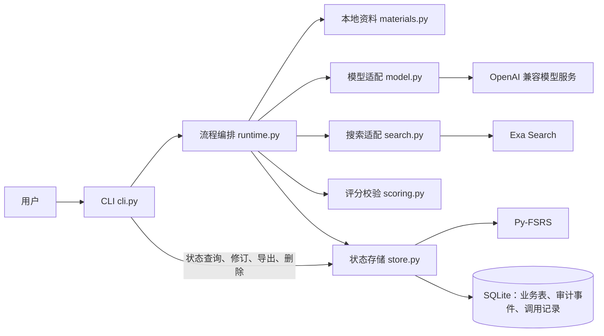
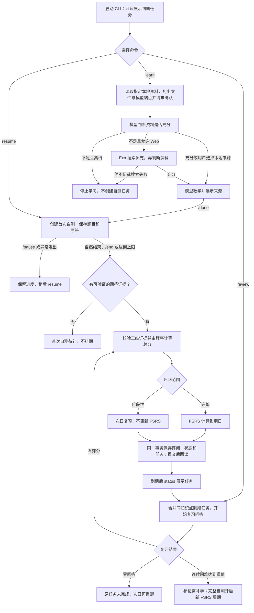

# 知秋

知秋是本地 CLI 学习 Agent。用户指定一个知识点和 `.md`／`.txt` 资料，确认学完后回答费曼问题；程序保存原题、原答、分维度评阅及复习任务。启动时只读查询到期任务。模型负责教学与语义评阅，业务写入、状态转换和 FSRS 排期由程序执行。

## 当前版本

当前代码 V1.0 范围是「本地资料学习 → 首次自测 → 首次排期 → 下次启动显示到期任务」。

## 项目结构与职责

```text
知秋V1.0/
├─ src/zhiqiu/
│  ├─ cli.py        CLI 命令、用户确认和交互会话
│  ├─ runtime.py    学习／复习流程编排与模型输出校验
│  ├─ materials.py  本地资料读取、范围限制和内容哈希
│  ├─ model.py      OpenAI 兼容 Chat Completions 适配器
│  ├─ search.py     Exa Search 适配器
│  ├─ scoring.py    证据校验、三维加权得分和 FSRS 档位映射
│  ├─ store.py      SQLite 权威状态、事务、审计事件与 FSRS 排期
│  ├─ quality.py    人工标注模板与评分质量检查
│  └─ clock.py      系统时钟与测试用固定时钟
├─ tests/           存储、流程、适配器及质量检查测试
└─ examples/        无密钥演示与真实服务联通脚本
```

核心调用关系如下。模型产出教学、题目和各维建议分数；`runtime.py` 校验结果，`scoring.py` 核对原题、原答和逐字证据；只有 `store.py` 改变业务状态，并在 SQLite 事务内保存评阅、FSRS 状态、复习任务及审计事件。`store.py` 在提交后回读确认，CLI 才向用户报告保存成功。



## 学习与复习流程

下图展示已实现的主要业务路径。`status` 和每次启动的到期提醒只查询任务；看到提醒不会完成复习。首次自测没有可评分回答时保留待补状态，不产生首次任务。



运行边界：一次问答最多 8 题或 25 分钟；完整评阅按概念准确、机制解释、应用辨析分别给 0–4 分，权重为 50/30/20。完整得分映射为 FSRS 的 Again、Hard、Good、Easy；阶段性评阅统一次日提醒。`revise` 会根据修订后的分数重算受影响的 FSRS 状态和未开始任务的到期日。

## 快速运行

以下命令均在**包含 `pyproject.toml` 的项目目录**运行；

```powershell
cd D:\code\知秋\知秋V1.0
uv run --python 3.12 python examples/demo.py
```

演示使用固定时钟和脚本化模型，不需要 API 密钥。

## 安装与配置

需要 Python 3.12 和 `uv`：

```powershell
uv sync --python 3.12 --extra test
$env:ZHIQIU_LLM_BASE_URL = 'https://your-provider.example/v1'
$env:ZHIQIU_LLM_MODEL = 'your-model'
$env:ZHIQIU_LLM_API_KEY = 'your-key'
# 仅需要 Web 补充时配置：
$env:ZHIQIU_EXA_API_KEY = 'your-exa-key'
```

模型端点须支持 OpenAI 风格的 Chat Completions；Web 补充还须支持工具调用。真实模型与 Exa Search 会产生外部请求。开始学习前，CLI 列出将发送的本地文件和模型端点，用户确认后才发送。Web 搜索只发送查询字符串。密钥不写入数据库或导出文件。Exa Starter 提供每月免费额度，但并非无限免费；请在 [Exa 官方价格页](https://exa.ai/pricing)核对当前额度。

默认数据库位于操作系统用户数据目录的 `zhiqiu/state.sqlite`，也可用全局 `--db PATH` 指定。命令：

```powershell
uv run zhiqiu --db .\state.sqlite learn '二叉树遍历' --from .\notes.md
uv run zhiqiu --db .\state.sqlite status
uv run zhiqiu --db .\state.sqlite resume
uv run zhiqiu --db .\state.sqlite review
uv run zhiqiu --db .\state.sqlite revise REVIEW_ID concept 3 --reason '原答支持基本正确'
uv run zhiqiu --db .\state.sqlite trace ATTEMPT_ID
uv run zhiqiu --db .\state.sqlite labels-template --json .\human-labels.json
uv run zhiqiu --db .\state.sqlite evaluate --labels .\human-labels.json
uv run zhiqiu --db .\state.sqlite export --json .\backup.json
uv run zhiqiu --db .\state.sqlite forget '二叉树遍历'
```

会话内 `/done` 确认学完并开始自测，`/pause` 保存问答进度，`/end` 明确结案，`/sources web|local` 纠正资料选择，`/accept N` 接受关联知识点建议，`/question 文本` 记录并解释澄清问题。直接关闭或异常退出不会自动结案。`--offline` 禁止 Web 补充。每次启动展示到期任务；查看提醒不视为完成。低分维度关联的原题原答会成为后续复习出题的重点，修订分数后随之更新。

完整评阅按概念准确、机制解释、应用辨析分别打 0–4 分，权重为 50/30/20。程序根据原答证据计算总分，再映射到 FSRS 四档。使用 Py-FSRS 6.3.2、90% 目标回忆率、365 天上限，关闭分钟级步骤和随机扰动。阶段性评阅次日复习且不更新 FSRS；零回答不新建任务。当前不计算 70/30 平滑掌握度。

## 验证

```powershell
uv run --python 3.12 --extra test python -m pytest -q
uv run --python 3.12 python examples/demo.py
```

服务环境变量配置后，可运行 `uv run --python 3.12 python examples/live_smoke.py` 检查真实模型与 Exa 的响应结构。该脚本仅向服务发送公开合成示例文本，不读取个人学习资料。

测试覆盖持久化恢复、写入故障回滚、幂等任务、只读提醒、资料不足、Web 搜索兜底、评分修订、每日额度、零回答顺延和补学新周期。`examples/demo.py` 使用固定时钟和脚本化模型，不需 API 密钥。

真实评分质量须准备至少 30 项人工标注的维度评分。`labels-template` 导出原题、原答、模型分数和证据；人工审阅后在每项的 `human_score` 填入 0–4 整数，再运行 `evaluate`。该命令核对精确一致率是否达到 80%，并逐项检查证据是否仍在原答中。模板含原始回答，请存放在私人位置。脚本化模型的测试数据不能替代人工标注。没有提供密钥时，真实模型及 Exa 服务的联通不能视为已验证。
