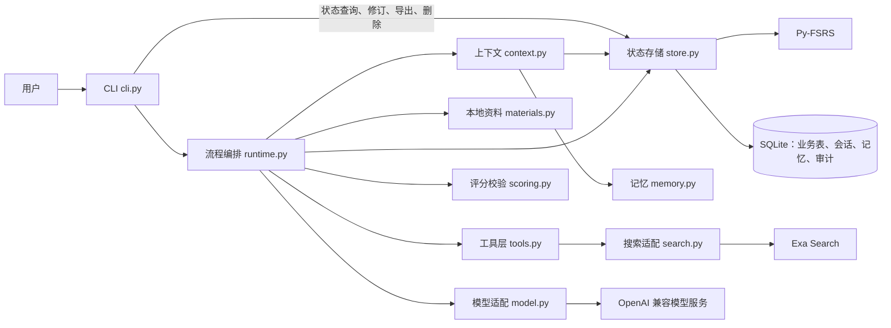

# 功能与结构

功能概览（按版本）和源码各模块的职责。返回 [README](../README.md)。

## 功能概览

- **大模型接入**：OpenAI 兼容的 Chat Completions 适配器，每次调用记录耗时、token 用量与状态；按模型配置窗口、输出预留与余量。
- **上下文构建**：教学、澄清、出题、评阅分别使用版本化的固定模板；每次请求区分必需内容与可选内容，按预算取舍，并记录纳入、排除的来源及原因。连续澄清和出题在同一会话内追加消息，复用已测量的请求前缀。
- **会话与记忆**：会话跨进程恢复；语义记忆只接受用户显式设置；评阅成功后异步生成有来源的情景摘要；跨天追问旧讲解时先用摘要，来源被更正后摘要失效并按需重建。
- **评分**：同一维度可有多道题，题目难度在作答前固定；模型对每个维度给一个 0–4 分并引用原答逐字证据，程序核对题目覆盖与引文后按 50/30/20 计算总分。证据放不进一次调用时按维度、按题分批；仍无法可靠评阅时进入待评阅，不产生分数或排期。
- **评分质量检查**：人工标注模板与一致率核对工具，用于验证模型评分与人工判断的一致性。
- **对话与运行时**（V4）：默认自由对话（有界 ReAct 循环，可用全部工具）；模型只能“提议”进入流程或记住偏好，由用户确认、程序执行。业务状态和对话模式都有显式的状态转换表，每次迁移写事件，中断后读状态字段恢复。
- **观测与治理**（V5）：每轮对话或每次命令一条 trace（span 树，开始时即落库）；`zhiqiu dashboard` 本地网页看板实时显示运行到哪一步，并有 trace 瀑布图、指标与花费、学习记录；`metrics` 汇总成功率、延迟、token、花费与人工确认；护栏每次触发写 `GuardrailTriggered`，密钥按值集中脱敏；`check` 对真实记录做运行契约检查，`failures` 分类失败并可导出为回归样例；`gate` 是发布门禁。见“观测与治理”。
- **界面与审批**（V6）：对话中的联网、外部 MCP、写文件按审批策略自动执行、询问或不提供（默认联网自动、其余询问，`ZHIQIU_APPROVAL_CONFIG` 可改，写文件不能自动）；每次放行记下来源（策略、用户、本轮已允许），每次询问留一条审批记录。`zhiqiu web` 本地网页工作台：在浏览器里对话、走完学习与复习、在卡片上批准或拒绝动作，右侧状态面板显示当前目标、上下文范围、执行状态、风险动作与验证结果；写接口只接受本机页面带令牌的请求。见“审批策略”“网页工作台”。
- **循序渐进的讲解**（6.1）：讲解分成 3–5 节逐节显示，每节一个小目标、结尾一个检查问题，说“继续”看下一节、说“学完了”开始自测；澄清只回答当前问题，不复述内部状态，也不宣布程序动作；对话中提议学习时一并列出要发送的资料，确认一次即可。见“讲解方式”。
- **学习体验与会话切换**（V7）：出题一题一问（程序校验问号数和长度，不合格重出一次）；评阅默认每个维度一行，`/detail` 或网页“展开详情”看原题原答与完整理由；自测中半答半问的输入可以拆开处理，每次分类都留痕；老讲解按“一、二、三”标题分节继续；会话有标题（命令规则、模型首轮命名、用户改名），工作台左侧会话侧栏可以切换、新建、改名，界面不再显示完整 UUID。见“自测中的出题与输入”“评阅结果的显示”“会话与切换”。
- **教学 Skill**（7.2）：讲解和澄清的“怎么教”放在带版本号的 `SKILL.md` 文件里（内置“通用讲解”和“费曼学习法”，也可以在自己的 Skill 目录里加），规则和输出结构仍写在代码里；渐进式披露：资料评估时模型只看到各个 Skill 的名称和描述，顺带选一个，程序校验后讲解和澄清才读入它的正文；`/skill` 查看或指定讲法，trace 记下用了哪个 Skill、哪一版、谁选的、为什么。见“教学 Skill”。
- **讲解配图与本地语音**（7.2）：讲解某一节可以带一张流程图、树或概念图（程序校验，工作台画成 SVG，终端打印文字版）；工作台按住麦克风说话，本机 SenseVoice-Small（sherpa-onnx，CPU）离线转写，按知识点标题修正同音术语，填进输入框由你确认后发送，录音不保存，来自语音的回答带“语音”标记。见“教学 Skill”“语音输入”。
- **FastAPI 服务层与流式输出**（V8.0）：看板和工作台改由 FastAPI + uvicorn 提供（接口路径、状态码和 JSON 不变，安全检查集中定义）；对话事件用 SSE 实时推送（`/api/chat/stream`，断线按最后一个事件续传，连不上时自动改回轮询）；模型调用默认流式，对话回答在网页和终端里逐字出现，讲解、出题、评阅等 JSON 阶段显示“已写约 N 字”；每次流式调用记下首字耗时（`ttft_ms`），看板和 `metrics` 显示其 p50／p95。`ZHIQIU_LLM_STREAM=0` 关闭流式。见“网页工作台”“流式输出”。
- **复习日程、目录白名单与审批页**（7.1）：看板“复习日程”按周、月显示逾期、今天和未来的复习，加未来 14 天负载（超过每日 3 次的那天标红），工作台里点到期条目即开始复习；工作台“目录白名单”页可以粘贴绝对路径、先预览再添加或移除可读／可写目录，在两轮对话之间生效、不用重启，环境变量里的目录只能看，每次改动记 `RootsChanged`，知秋自己没有任何办法改这份名单；审批页可以直接批准或拒绝工作台正在等待的动作。见“本地看板”“网页工作台”。

- **易用性与兜底**（9.0）：用户级配置文件 `config.toml`（`zhiqiu config init/show/get/path`，配套 `config.example.toml`、`.env.example`），不带参数运行 `zhiqiu` 可直接打开工作台；端点拒绝 `stream`、`tools`、`thinking` 等字段时自动去掉重试并按“端点 + 模型”记住，其他错误给中文说明；学习资料支持代码、配置与笔记本，上限可配置（默认 50 万字）；对话中读写白名单外的文件改为在对话里申请（只允许这一次、加入白名单或拒绝）；语音依赖随基础安装，模型在第一次使用时自动下载；README 拆分为 `docs/`。见[安装与配置](configuration.md)、[学习](learning.md)、[对话](chat.md)、[语音](voice.md)。

## 项目结构与职责

```text
.
├─ src/zhiqiu/
│  ├─ cli.py          CLI 命令、终端输入输出与用户确认
│  ├─ agent.py        `zhiqiu chat` 对话外壳：有界 ReAct 循环、提议与确认、斜杠命令
│  ├─ approvals.py    对话审批策略：联网、外部 MCP、写文件按 allow／ask／deny 执行
│  ├─ webio.py        网页工作台的 FlowIO（事件日志、等待网页回答的提示）与运行对话的工作线程
│  ├─ conversations.py 对话与对话消息的保存、按天划分、模式切换与删除
│  ├─ flows.py        讲解、自测与复习的输入循环（终端与对话模式共用）
│  ├─ lessons.py      讲解分节：校验、渲染、进度标记与“继续／学完了”的识别
│  ├─ flow.py         状态转换表与统一的状态转换入口
│  ├─ runtime.py      学习／复习流程编排与模型输出校验
│  ├─ context.py      分阶段上下文组装、预算检查与审计
│  ├─ model.py        OpenAI 兼容 Chat Completions 适配器
│  ├─ scoring.py      评分标准、证据校验、加权总分与 FSRS 档位映射
│  ├─ store.py        SQLite 权威状态、迁移、事务、审计事件与 FSRS 排期
│  ├─ notion.py       Notion 官方 API 读取页面并转成 Markdown
│  ├─ mcp_client.py   连接本地 stdio MCP 服务，白名单工具接入工具层
│  ├─ mcp_server.py   `zhiqiu mcp`：只读 MCP 服务（stdio），审计写 JSONL
│  ├─ queries.py      状态、到期、知识点与 trace 的只读查询（Store 与只读工具共用同一份 SQL）
│  ├─ memory.py       显式语义记忆、情景摘要与旧讲解摘要
│  ├─ retrieval.py    旧讲解追问的可解释排序
│  ├─ history.py      对话工具 search_history：讲解与对话的 FTS5 关键词检索
│  ├─ materials.py    本地资料读取、范围限制和内容哈希
│  ├─ search.py       Exa Search 适配器与 web_search 工具声明
│  ├─ tools.py        工具声明、注册、参数校验、执行闸门、重试、截断与审计
│  ├─ toolloop.py     资料准备与学习阶段澄清内的有界工具循环、搜索查询泄露检查
│  ├─ files.py        read_file（只读已授权资料）与 write_file（只写指定目录、逐次确认）
│  ├─ quality.py      人工标注模板、评分质量检查、评分提示指纹与评测记录
│  ├─ tracing.py      trace：span 树、当前 span（contextvars）、进度与中断标记
│  ├─ traces.py       trace 列表、树、实时运行链与终端时间线
│  ├─ metrics.py      指标聚合（读取时计算）；pricing.py 按 token 推算花费
│  ├─ guardrails.py   护栏触发的统一事件；redact.py 按值脱敏
│  ├─ contracts.py    运行契约检查（PASS／FAIL／证据不足）与失败分类
│  ├─ regressions.py  校验失败的模型原文导出为回归样例
│  ├─ gate.py         发布门禁
│  ├─ dashboard.py    看板与工作台各接口返回的数据、服务器对象（dashboard.html 为页面）
│  ├─ web/            FastAPI 应用：app.py 路由，security.py 请求检查与响应头，sse.py 对话事件流
│  ├─ diagnostics.py  模型联通、预算与窗口容量检查
│  ├─ local_env.py    读取项目根目录的 .env
│  ├─ config.py       用户级 config.toml：设置表、校验、来源记录、生成示例（9.0）
│  ├─ capabilities.py 端点拒绝的请求字段：识别、去掉重试、按端点记住（9.0）
│  ├─ texttypes.py    哪些文件按文本读取（文档、代码、配置、笔记本）与读取方式（9.0）
│  ├─ voice_install.py 语音模型的下载、校验与安全解压（9.0）
│  └─ clock.py        系统时钟与测试用固定时钟
├─ tests/             存储、流程、上下文、评分、检索与诊断测试；test_scenarios.py 为端到端场景套件，
│                     regressions/ 为从真实失败沉淀的回归样例
├─ examples/          无密钥演示、真实服务联通与评分验收脚本
├─ scripts/           Windows 桌面入口：zhiqiu-web.ps1 打开工作台，install-shortcut.ps1 生成桌面快捷方式
└─ labels/            人工标注与检索校准用的公开合成样本；eval-runs.jsonl 为评分评测记录（随代码提交）
```

设计原则是“模型提出建议，程序做出决定”。模型的输出一律视为不可信输入：`runtime.py` 校验结构，`scoring.py` 核对原题、原答与逐字证据；只有 `store.py` 改变业务状态，并在一个 SQLite 事务内保存评阅、FSRS 状态、复习任务与审计事件，提交后回读确认，CLI 才报告保存成功。



所有模型调用都经过 `LearningRuntime._invoke`：先由 `ContextManager.build` 按阶段组装请求并检查预算，再交给适配器发送，返回的必须是 JSON 对象。必需内容超预算时改用已检查过的资料摘要；服务端报告窗口溢出时去掉可选内容重试一次。业务流程中的调用次数与顺序由程序决定；只有对话模式和两个学习步骤开放有界工具循环（见“工具层”“对话模式”）。
