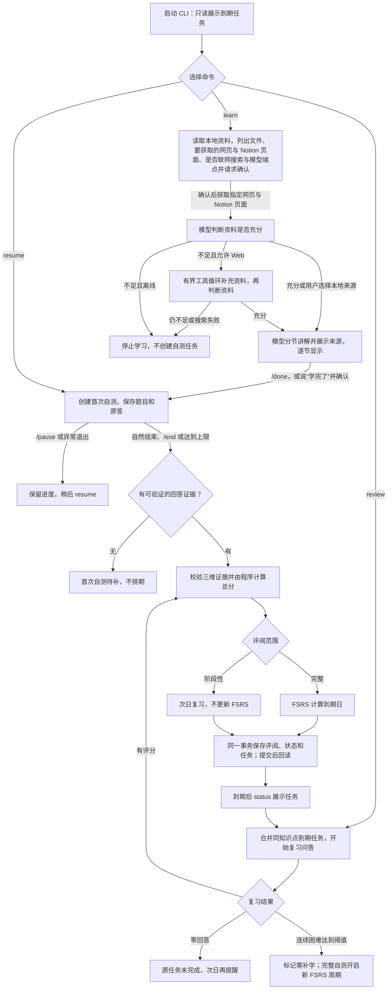

# 学习、自测与复习

讲解、出题、评阅、评分规则、状态机，以及跨天追问。返回 [README](../README.md)。

## 学习与复习流程

`status` 和每次启动的到期提醒只查询任务；看到提醒不会完成复习。首次自测没有可评分回答时保留待补状态，不产生首次任务。



### 讲解方式

讲解一次生成（只调用一次模型），分成 3–5 节逐节显示。每节只讲一个小目标，先讲直觉再讲细节，正文不超过 300 字，结尾是一个一两句话就能回答的检查问题（“想一想：……”）。事实以资料为准，但不按资料的顺序和措辞复述。讲解阶段可以：

- 回答检查问题或直接提问：交给澄清，模型会拿到当前这一节和它的检查问题，简短指出答对的地方和缺少的地方；
- 说“继续”“下一节”“接着讲”：显示下一节，不调用模型；最后一节之后显示可独立学习的建议（`/accept N`）；
- 说“学完了”“讲完了”“开始自测”等：先确认“结束讲解，开始自测吗？”（还有没看的节时会注明），确认后等同 `/done`；输入 `/done` 不再确认。

这些说法只在去掉空格和句末标点后完全一致时才识别，“懂了”“明白了”不算（它们也可能是在回答检查问题）。整篇讲解仍作为一条 `lesson` 消息保存，出题、评阅和澄清的上下文不变；各节内容记在 `LessonSections` 事件里，每显示一节写一条 `lesson_section` 标记，所以 `/resume` 会列出各节标题并从第一节没看过的继续。

分节之前（6.1.0 以前）的旧讲解恢复时，如果有两个以上行首的中文序号标题（“一、”“二、”……），就按标题切成几节：第一个标题之前的内容是“概述”，最后的“补充：……”留在最后一节，同样逐节显示并留下 `lesson_section` 标记，下次从没看过的一节继续（跨天继续时标记仍指向原讲解）。切分每次现算，不调用模型，也不改存储的讲解原文；没有序号标题的旧讲解照旧整篇显示。

### 教学 Skill（7.2）

讲解（`teach`）和澄清（`clarify`、分段核对后的 `clarify_combine`）的提示由三部分拼成：代码里的固定开头 → Skill 里这一阶段的教法 → 代码里的篇幅、配图、规则和输出结构，最后是共用的数据规则。固定部分在 Skill 之后，所以哪个 Skill 都去不掉“事实以资料为准”“不提内部记录”“不宣布程序动作”这些规则，也改不了输出的 JSON 结构。

- **内置 Skill**（`src/zhiqiu/skills/<名称>/SKILL.md`，随包发布）：`general`（通用讲解，就是 7.1 之前写死的那套教法，兜底用）和 `feynman`（费曼学习法：先用大白话和日常类比讲清核心、少用术语，每节让你用自己的话复述，澄清时先肯定说对的、再指出复述里最多两处漏洞，请你再说一遍）。
- **自己的 Skill**：放在 `ZHIQIU_SKILLS_DIR`（默认 `%LOCALAPPDATA%\zhiqiu\skills`），每个子目录一个 `SKILL.md`。改了文件下一次 `/learn` 就生效，不用重启。格式：

  ```markdown
  ---
  name: leetcode            # 小写字母、数字、连字符，与目录同名
  version: 1                # 改内容时自己加 1（trace 另记内容摘要）
  title: 刷题讲解            # ≤20 字
  description: 算法题：先手推小例子，再给解题模板和复杂度   # ≤120 字，模型选 Skill 时只看这一句
  stages: [teach]           # teach 必填；不写 clarify 时澄清用通用讲解
  sections: 2-4             # 可选：节数 1–8，默认 3-5
  section_chars: 300        # 可选：每节字数 100–800
  answer_chars: 200         # 可选：澄清回答字数 80–500
  diagrams: 1               # 可选：一份讲解最多几张图 0–3，默认 0
  ---

  ## teach

  （怎么讲，30–1500 字，不能有花括号）
  ```

  不合规、和内置 Skill 同名、或者总数超过 20 个的，只跳过那一个，原因列在 `zhiqiu skills` 和工作台状态面板里；内置 Skill 坏了则直接报错。Skill 正文会进入讲解和澄清的系统提示，信任级别等同你自己写的指令：从网上复制的 Skill 先读一遍再放进来。
- **谁也改不了 Skill 目录**：可写目录（环境变量或工作台白名单）不能是 Skill 目录本身、它的上级或下级，白名单预览会直接拒绝；如果 `.env` 里的可写目录和 Skill 目录重叠，全部用户 Skill 停用并给出警告。知秋没有任何工具能写 Skill。
- **怎么选（渐进式披露）**：资料评估（`assess`／`assess_combine`）的输入里多一份 Skill 目录，只有名称、标题和描述，模型除了判断资料够不够，再返回 `skill` 和一句 `skill_reason`。程序校验名称存在且能讲解，否则用 `general` 并在 trace 标出 `skill_invalid`，学习照常进行。选中的 Skill 记到知识点上（`SkillChanged` 事件带理由），之后对这个知识点的澄清也用它。不额外调用模型。
- **`/skill`**：讲解、自测、复习中 `/skill` 列出可用的 Skill 并标出当前用的是哪个、谁定的；`/skill 名称`（或中文标题）改当前知识点，`/skill auto` 交还给模型；对话里写 `/skill 名称 知识点标题`、`/skill auto 知识点标题`。你指定的不会被模型覆盖；指定的 Skill 被删了就本次用通用讲解并提示。改了不自动重讲，想用新讲法再 `/learn` 一次。斜杠命令不调用模型。
- **观测**：讲解卡片上方一行“讲法：费曼学习法（/skill 可改）”；Trace 详情里资料评估一步显示“选择 Skill：feynman（理由：……）”，讲解和澄清显示所用 Skill、来源（内置／用户）和谁定的（模型／用户／通用兜底）；模型调用详情显示 Skill 名、版本和内容摘要；`context_builds` 记 `skill_name`、`skill_version`、`skill_sha`、`skill_source`，`zhiqiu check` 的 `skills_recorded` 检查每次讲解和澄清都记了 Skill。`zhiqiu skills [--json]` 列出所有 Skill 和错误。
- **讲解配图**：Skill 的 `diagrams` 允许时（两个内置 Skill 都是 2），讲解的某一节可以带一张图：`flow`（流程图，带箭头，可以有回路）、`tree`（树，单根）或 `map`（概念图，连线写关系），每张 2–12 个节点、1–20 条连线，节点要连成一片。程序逐项校验：同一条连线写了两次会合并成一条（标签用“／”连起来），其他不合规的只丢掉这张图（这一节的文字照常显示），原因记在 `LessonSections` 事件的 `dropped_diagrams` 里，讲解这一步的 span 记 `diagram_invalid`。图的文字形式（树用 `├─`／`└─`，流程和概念图每条连线一行 `A —标签→ B`）也写进保存的讲解原文，所以出题、评阅和澄清都看得到图里的内容；终端直接打印文字形式。工作台用原生 SVG 画在这一节正文和检查问题之间（分层布局，回路画成虚线弯边，深浅主题都可读），比卡片宽时只在图里横向滚动，图下有“文字版”开关。
- **讲解输出无法解析**：带图的讲解是一段较长的 JSON，模型偶尔会写坏（7.2 实测 10 次里 1 次）；讲解阶段遇到无法解析的输出会自动再请求一次（原文照常记进 `llm_failures`），第二次仍失败才报错停止。
- **版本**：7.2 改了这几个阶段的结构和资料评估的提示，`TEMPLATE_VERSION` 升为 `context-v15`（资料片段检查、分段追问、旧讲解归纳三张缓存各失效一次）；以后只改 Skill 不再升它。内置 Skill 内容变了而 `version` 没升，测试会失败。评分和分类的提示没有动；出题规则 `FOLLOWUP_RULES` 加了一句复习重点的说明（见下），评分提示指纹因此从 `dc26363f8ed3` 变为 `4a7d7e1fac39`。
- **复习重点**：复习时出题阶段会收到以前得分不超过 2 的旧题、旧回答和评分理由（`focus`）。它们不带题目和回答的 id，出题规则也写明 focus 不是本次问答的记录：本次已答的题只看 `current_attempt`，focus 里的题既不算已作答，也不能被追问，复习要针对其中的错点出新题。7.2 之前这里带着旧题 id，真实复习中模型把旧题当成本次已答的题，一开题就回 `done` 或去追问旧题，复习无法开始。

### 自测中的出题与输入

出题一题一问（V7）：`next_question` 的提示要求每题只含一个问号、题干不超过 60 字、2 到 4 句话能答完；需要手推的题由题目给一个最小例子，只问其中一步；追问只针对原答里最含糊的一句，可以引用原话，不得重复或改写原题，也不得要求“展开讲”。程序在保存题目前用 `scoring.question_shape` 校验：中英文问号合计超过 `QUESTION_MAX_MARKS = 1` 个，或去掉空白后超过 `QUESTION_MAX_CHARS = 80` 字（提示写 60，校验留余量），就带着原因重出一次，第一次的输出记入 `llm_failures`。重出后仍只是形状超限时题目照样保存、自测继续，并记一条 `GuardrailTriggered(rule=question_shape, action=warned)`；字段缺失、维度或追问目标非法等结构性错误仍然中止并保持可恢复。字面相似度拦不住“换个说法重问原题”，这一点靠提示约束和回归样本人工审阅。

不带前缀的自测输入先由 `classify_turn` 判断：

| 模型判断 | 处理 |
|---|---|
| `answer` 回答 | 直接保存为回答 |
| `question` 提问 | 提示“识别为提问，回车确认，输入 a 改为回答保存” |
| `mixed` 半答半问（拆分合法） | 提示三选一：回车＝分开处理（回答部分存为回答，提问部分走澄清），a＝整段作为回答，q＝整段作为提问 |
| 调用失败、拿不准、拆分不合法 | 让用户选 a（回答）或 q（提问） |

`mixed` 时模型须给出 `answer_text` 和 `question_text`，程序去掉首尾空白和标点后检查两段都不为空、都是原输入的子串，否则降级为“拿不准”。分开处理时评分只看得到回答部分。每次分类写一条 `TurnClassified` 事件：`question_id`、`model_kind`、`reason`（截到 200 字）、`split_valid`、`final`（answer／question／split）、`decided_by`（模型直接处理为 `model`，用户在提示里选择为 `user`）和 `input_chars`，**不存输入原文**；`flow` span 记 `classified_mixed` 次数，看板的学习记录详情列出这些分类。

### 评阅结果的显示

自测或复习结束后只显示摘要（V7）：

```
阶段性评阅 25 分 · 下次复习 10-17（明天）
  概念准确 1/4：只说了“链表只有 next”，没讲遍历是什么
    要点：遍历是按规则访问每个节点一次
  机制解释 3/4：说清了递归调用的顺序
  应用辨析：未评
输入 /detail 查看原题、原答和完整理由
```

每个维度一行：优先用评分给出的 `feedback`（给学习者看的一句话，提示要求不超过 60 字，存在 `dimension_scores.feedback`；缺失或超过 80 字时存空，不影响评分是否成立），没有时取 `rationale` 第一个句号之前的内容，超过 40 字截断。得分不超过 2 的维度另起一行“要点”，取 `supplement` 的第一句。之后回到对话只说“已回到对话。”，不再重复总分（`flow_result` 消息仍存完整摘要，状态面板“最近结果”照常显示）。`/detail` 显示本段对话最近一次评阅的完整内容（每个维度的引文、完整理由、补充，以及原题、原答），`/detail 短号` 查看指定尝试；自测进行中输入 `/detail` 会提示结束后再看。网页上摘要显示为评阅卡片，“展开详情”直接读只读的 `/api/attempt/<id>`，对话忙时也能展开。

澄清（讲解与自测中的提问）只回答当前这一个问题，先给结论，一般不超过 200 字；不提数据库字段或学习状态，不宣布、也不承诺程序动作（结束讲解、开始自测、安排复习、生成任务）。讲解中的澄清可以读资料、写笔记，但不提供对话用的状态查询工具。

### 状态机

业务状态只能经 `flow.py` 的 `transition`／`enter` 改变：先按声明的转换表检查，合法才更新字段，并在同一事务内写一条 `StateChanged` 事件（实体、ID、原状态、新状态、原因）；表外的转换抛出 `IllegalTransition`（`ValueError` 的子类），字段和事件都不变。声明为“到自身”的转换（如进行中的尝试再次 `resume`）不改字段、不写事件。原有的业务事件（`AttemptPaused`、`ReviewSaved` 等）照常写入。

| 实体（字段） | 转换 |
|---|---|
| 尝试（`attempts.state`） | 新建→`in_progress`；`in_progress`→`paused`／`awaiting_review`／`completed`／`needs_self_test`；`paused`、`needs_self_test`→`in_progress`；`awaiting_review`→`completed`；`completed` 为终点 |
| 复习任务（`review_tasks.state`） | 新建→`pending`；`pending`→`started`／`relearn_handled`；`started`→`done`／`pending`（零回答推迟）／`relearn_handled`；`relearn_handled`→`pending`（修订撤销补学）；`done` 为终点 |
| 知识点（`knowledge_points.state`） | 新建→`active`；`active`↔`needs_relearn` |
| 讲解（`sessions.lesson_state`） | 新建→`teaching`；`teaching`→`tested`（同日开始自测）／`closed`（`/end` 或跨天续讲时关闭旧会话）；`tested`、`closed` 为终点 |
| 对话（`conversations.mode`） | 新建→`chat`；`chat`→`lesson`／`self_test`／`review`；`lesson`→`self_test`／`chat`；`self_test`、`review`→`chat` |

待继续的讲解直接读 `lesson_state='teaching'`，不再从消息推算。讲解关闭后，当天再开始的讲解进入新会话，可以正常继续。v14 迁移按已有消息回填 `lesson_state`（已关联尝试为 `tested`，有关闭记录为 `closed`，其余有讲解的会话为 `teaching`）。

运行边界：一次问答最多 8 题或 25 分钟。完整评阅按概念准确、机制解释、应用辨析分别给 0–4 分，权重 50/30/20，得分映射为 FSRS 的 Again、Hard、Good、Easy；阶段性评阅统一次日提醒，零回答不新建任务。`revise` 按修订后的分数重算受影响的 FSRS 状态和未开始任务的到期日。使用 Py-FSRS 6.3.2、90% 目标回忆率、365 天上限，关闭分钟级步骤和随机扰动。

## 学习计划（10.0）

一个主题可以先制定学习计划：拆成若干知识点，每天学一点，复习一起算进当天的负荷。每个单元就是一次普通的学习（讲解、自测、复习都不变），首次自测完成时单元记为学完。制定、修改、排期规则、每日执行和提醒见[学习计划](plans.md)。

## 资料类型与上限（9.0）

`learn --from` 可以指向笔记，也可以指向代码仓库：

- 读取的类型：文档（`.md`、`.markdown`、`.txt`、`.rst`），常见代码（`.py`、`.js`、`.ts`、`.tsx`、`.java`、`.kt`、`.go`、`.rs`、`.c`、`.cpp`、`.cs`、`.rb`、`.php`、`.swift`、`.sql`、`.sh`、`.ps1` 等），配置与数据（`.json`、`.yaml`、`.toml`、`.ini`、`.xml`、`.csv`），前端（`.html`、`.css`、`.vue`、`.svelte`），以及 Jupyter 笔记本 `.ipynb`（只取 Markdown 和代码单元的源码，丢掉输出和图片）；没有扩展名的 `Dockerfile`、`Makefile`、`README`、`LICENSE` 也读。`materials.code_files = false` 时回到只读文档；`materials.extra_suffixes` 可以再加扩展名（如 `[".kt", ".lua"]`）。
- 扫描目录时跳过：以 `.` 开头的文件和目录，`node_modules`、`venv`、`__pycache__`、`dist`、`build`、`target` 等依赖与构建目录，带 `pyvenv.cfg` 的虚拟环境，锁文件和压缩过的 `*.min.js`；资料目录顶层有 `.gitignore` 时按它排除（`materials.respect_gitignore`，用 `pathspec` 解析）。
- 读取：前 8 KB 里有 NUL 字节的当作二进制跳过；编码先试 UTF-8（可带 BOM），再试 GBK，都不对就跳过；换行统一成 `\n`（与 8.0 一样，同一文件的内容哈希不变）。直接指定的单个文件读不了时报错说明原因。
- 上限（`[materials]`）：合计 `max_chars` 字（默认 500,000，8.0 为 100,000），单个文件 `max_file_bytes`（默认 2 MB，目录中更大的文件跳过并列出），一个目录最多 `max_files` 个可读文件（默认 500）。超出时的报错写明实际数量和该调哪一项。超出一次请求窗口的资料照旧按段检查再汇总（`assess_chunk`），结果缓存在 `material_checks`，重复学习同一份资料不再花钱。
- 发送确认：文件超过 30 个时只列前 20 个，其余按扩展名给出数量；多个文件时另写合计文件数和字数；超出一次请求上限时写明预计分几段、约几次模型调用；配置了价格时写出预计的输入花费；被跳过的文件按原因计数（不发送）。这些都只取决于文件内容和设置，所以确认后内容不变就不会再问。
- 代码资料发给模型时带 `lang` 字段（如 `python`），讲解里会引用文件名和函数名；文档的记录与 8.0 完全相同，提示模板和评分指纹都没有改。
- 写文件不受影响：对话和澄清里 `write_file` 仍只写 `.md`、`.txt`。

## 评分

评分标准写在 `scoring.py` 的 `RUBRIC`：0 为不会或完全错误，1 为有零散正确点但关键结论错误，2 为基础正确但深层不足，3 为基本完成但有一处明显不足，4 为完全答对或只有非关键遗漏，不因题目难度封顶。题目难度分为 `basic`、`advanced`、`transfer`，在作答前固定，作答后不能修改。同一维度有未答题时，未答题覆盖的要求视为未证明：只答了基础题且答对时最高 2，已答题中有答对的进阶或迁移题时最高 3。回答含糊时先在同一维度追问一次，再按澄清后的理解评分。

程序拒绝以下评分并让模型重评，校验失败的原因会反馈给重试：同一维度出现多项、漏评或重评某道题、引文不在原答中、未答题带有证据、分数不在 0–4。重试仍未通过则进入 `awaiting_review`。

原答本身超预算时，尝试进入 `awaiting_review`，原答保留。可用 `submit-final` 另存一份精简的评分答案，再用 `resume` 继续。评原答的分段路径（`resume ATTEMPT_ID --grade-original`）把原答按段落、句子边界切成无重叠且覆盖全文的片段，逐段提取正确点、错误点、未决点与短引文，进度按尝试、答案、内容哈希、规则版本和模型版本缓存，汇总时检查跨片矛盾。该路径默认关闭，需设置 `ZHIQIU_LONG_ANSWER_SEGMENTS=1`。

## 记忆与跨天追问

- `memory set/list/delete` 管理语义记忆，需给出作用范围与来源；知识点专属的同名设置覆盖全局设置。对话中只有经用户确认的 `propose_memory` 会写入记忆，不会自动保存。
- 跨天追问旧讲解时开启新会话，通过来源 ID 关联旧讲解；摘要按需生成并缓存，`correct-lesson` 追加更正后旧摘要失效。
- `ask` 未指定 `--source` 且有多次旧讲解时，按追问内容对旧讲解排序：汉字二元组按候选集合做 IDF 加权重合，英文与数字按整词匹配，“为什么、怎么、而不是”等疑问与虚词短语不参与匹配，再加上最长共同片段和较弱的时间衰减。最高分达到阈值且明显领先时自动选用并说明，否则列出前 3 个候选，提示用 `--source` 指定或用 `--all` 逐次处理。每次排序的分数、信号和取舍理由记为 `LessonRetrieval` 事件。排序参数用 `labels/retrieval/cases.json` 校准（`examples/calibrate_retrieval.py`）。
